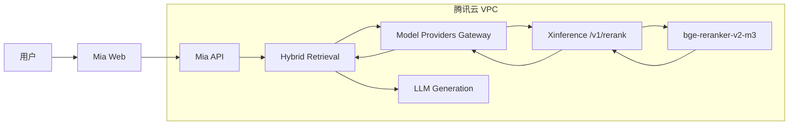

# Mia 本地 Rerank 部署选型与落地技术方案

## 1. 文档定位

本文定义 Mia 在腾讯云或本地环境中私有化部署 Rerank 模型的技术方案，目标是在不把用户 Query 和知识库 Chunk 发送给外部模型服务的前提下，为现有 RAG 混合检索增加 Cross-Encoder 重排序能力。

本方案与以下文档配套：

- [RAG 混合双检索技术设计](./rag-hybrid-retrieval-technical-design.md)
- [Mia 接入腾讯云智能搜索 Rerank API 技术方案](./tencent-cloud-rerank-api-technical-design.md)

总体结论：

```text
首选部署框架：Xinference
首选模型：BAAI/bge-reranker-v2-m3
首选部署位置：Mia 所在腾讯云 VPC
首选协议：POST /v1/rerank
首选运行设备：NVIDIA T4 16GB 或同等级 GPU
安全原则：模型权重本地化、服务无公网入口、推理容器禁止公网出口
```

本方案当前状态为“待实施”，不表示仓库已经包含 Xinference、vLLM 或 TEI 服务。

## 2. 背景

Mia 已完成：

```text
向量语义召回
  + PostgreSQL FTS / trigram 关键词召回
  -> 加权 RRF 融合
  -> 去重、阈值和 Top K
```

RRF 能够融合两路排名，但不会对 Query 和单个候选 Chunk 做深层成对判断。Cross-Encoder Rerank 可以在小规模候选集上进一步判断：

```text
query + document -> relevance score
```

直接使用远程 Rerank API 会把以下数据发送到外部服务：

- 用户问题。
- 候选 Chunk 正文。
- 可选的文档名和标题路径。

对于包含内部制度、客户信息、源代码、故障日志或商业数据的知识库，团队可能不允许这些内容离开自有 VPC。因此需要本地推理方案。

## 3. 目标与非目标

### 3.1 目标

1. Query、Chunk 和推理结果只在 Mia 所在 VPC 或物理内网流转。
2. 提供与远程服务相近的 `/v1/rerank` HTTP API。
3. Mia 的 Retrieval 业务层不感知本地或远程部署差异。
4. 支持中文和多语言知识库。
5. 支持 CPU 验证和 GPU 生产部署。
6. 支持模型权重离线准备、版本固定和完整性校验。
7. Rerank 服务无公网入口，并支持认证、限流和监控。
8. 服务不可用时回退现有 RRF 结果。
9. 能通过 Agent 配置在本地与远程 Rerank Provider 之间切换。
10. 提供部署、压测、灰度、回滚和验收标准。

### 3.2 非目标

- 不使用 Ollama Chat Prompt 模拟 Rerank。
- 不在第一阶段训练或微调 Reranker。
- 不把整个知识库发送到 Rerank 服务，只发送本次候选集。
- 不将 Rerank 服务暴露给互联网用户。
- 不在第一阶段实现跨地域多活 GPU 集群。
- 不用 Rerank 替代向量和关键词召回。
- 不强制所有 Agent 默认启用 Rerank。

## 4. 为什么不直接使用 Ollama

Ollama 主要提供生成式模型和 Embedding 能力。即使可以通过 Prompt 让 LLM 对多个文档排序，也存在以下问题：

- 延迟和显存消耗明显高于专用 Cross-Encoder。
- 输出依赖 Prompt 和 JSON 解析，不够确定。
- 难以获得稳定、可比较的相关度分数。
- 长候选列表会显著增加上下文 Token。
- 模型可能漏项、重复索引或输出解释文本。

专用 Reranker 直接计算 Query-Document 相关度，适合对 10-50 个候选做快速重排。因此本方案追求的是“类似 Ollama 的本地模型管理体验”，不是让 Ollama 执行 Rerank。

## 5. 候选方案

本方案比较：

1. Xinference。
2. vLLM。
3. Hugging Face Text Embeddings Inference（TEI）。
4. 自建 Python + FlagEmbedding 服务。
5. Ollama + LLM Prompt 模拟排序。

## 6. 总体对比

| 维度              | Xinference   | vLLM         | TEI            | Python + FlagEmbedding | Ollama Prompt  |
| ----------------- | ------------ | ------------ | -------------- | ---------------------- | -------------- |
| 本地部署          | 支持         | 支持         | 支持           | 支持                   | 支持           |
| Rerank 专用 API   | `/v1/rerank` | `/v1/rerank` | `/rerank`      | 需要自建               | 无标准专用 API |
| 请求字段          | `documents`  | `documents`  | `texts`        | 自定义                 | Prompt         |
| Web UI / 模型管理 | 有           | 无           | 无             | 无                     | 有             |
| CPU 支持          | 支持         | 非首选       | 支持           | 支持                   | 支持           |
| GPU 吞吐          | 良好         | 最强         | 良好           | 取决于实现             | 成本较高       |
| 动态批处理        | 框架管理     | 强           | 强             | 需要自建               | 框架管理       |
| 内置 Rerank 模型  | 多           | 依赖兼容列表 | 较少但稳定     | 任意 Transformers      | 非专用         |
| Mia 接入改造      | 低           | 低           | 中             | 高                     | 中             |
| 运维复杂度        | 中           | 中           | 低             | 高                     | 低             |
| 生产推荐          | 首选         | 高吞吐场景   | 单模型轻量场景 | 不推荐                 | 不推荐         |

官方资料：

- [Xinference 内置 Rerank 模型](https://inference.readthedocs.io/en/stable/models/builtin/rerank/)
- [Xinference Rerank API](https://inference.readthedocs.io/en/v0.14.2/models/model_abilities/rerank.html)
- [vLLM Scoring 与 Rerank API](https://docs.vllm.ai/en/latest/models/pooling_models/scoring/)
- [TEI Rerank 与离线部署](https://huggingface.co/docs/text-embeddings-inference/en/quick_tour)

## 7. 方案一：Xinference

### 7.1 定位

Xinference 是本方案的默认选择。它提供类似 Ollama 的本地模型管理体验，并原生支持 Rerank 模型和 `/v1/rerank`。

内置模型包括：

- `bge-reranker-base`
- `bge-reranker-large`
- `bge-reranker-v2-m3`
- `bge-reranker-v2-gemma`
- `bge-reranker-v2-minicpm-layerwise`
- `bce-reranker-base_v1`
- `Qwen3-Reranker-0.6B`
- `Qwen3-Reranker-4B`
- `Qwen3-Reranker-8B`

### 7.2 优点

- 提供 Web UI 和模型启动、停止、注册能力。
- `/v1/rerank` 与腾讯云远程协议接近。
- 支持 Hugging Face 和 ModelScope 模型源。
- 支持 CPU、GPU 和 Docker。
- 可以同时托管 Embedding、Rerank 和其他模型。
- 新版提供用户、权限和 API Key 管理。
- Mia 可以继续使用 OpenAI-compatible Provider 抽象。

### 7.3 缺点

- 比单模型 TEI 服务更重。
- 版本升级可能改变 CUDA、驱动和推理引擎要求。
- 新版本会按模型创建运行环境，首次启动可能下载 Python 依赖。
- 严格离线环境需要提前准备镜像、依赖和模型权重。
- 如果同一实例同时托管很多模型，资源隔离需要额外治理。

### 7.4 适用范围

适合：

- 希望通过 UI 管理本地模型。
- 后续可能增加多个 Reranker。
- 希望在 BGE 与 Qwen3 之间切换。
- 需要和远程腾讯云 Provider 使用相似协议。

## 8. 方案二：vLLM

### 8.1 定位

vLLM 适合已经具备 GPU 推理运维能力、重视吞吐和动态批处理的环境。

当前 vLLM 提供：

```text
/score
/v1/score
/rerank
/v1/rerank
/v2/rerank
```

其中 `/v1/rerank`、`/v2/rerank` 采用 Cohere/Jina 风格请求，可返回 `index` 和 `relevance_score`。

### 8.2 优点

- GPU 吞吐和动态批处理能力强。
- 请求协议与 Mia 规划的统一 Rerank DTO 接近。
- 支持 Cross-Encoder、Late Interaction 和 Bi-Encoder Score。
- 支持 Qwen3 Reranker 等新模型。
- 适合已有统一 vLLM 推理平台的团队。

### 8.3 缺点

- 没有类似 Ollama/Xinference 的完整模型管理 UI。
- 部分模型需要 `--hf-overrides` 和 Chat Template。
- GPU、CUDA、PyTorch 和模型架构兼容性更复杂。
- 对 Mia 当前低并发场景可能过度配置。
- 安全配置需要特别检查。

### 8.4 安全注意事项

vLLM 官方安全文档指出，部分非 `/v1` 推理端点即使设置 API Key 也可能不受保护。本方案必须：

- 只从 Mia 调用 `/v1/rerank`。
- Rerank 端口不暴露公网。
- 使用安全组、Kubernetes NetworkPolicy 或反向代理限制来源。
- 不能仅依赖 vLLM 自身 API Key 作为唯一安全边界。

[vLLM 安全说明](https://docs.vllm.ai/en/stable/usage/security/)

### 8.5 适用范围

适合：

- 预计 Rerank 请求量较高。
- 已经有 vLLM GPU 集群。
- 需要 Qwen3-Reranker 或更复杂的 Score 模型。
- 有能力维护模板、模型覆盖配置和 GPU 调度。

## 9. 方案三：Hugging Face TEI

### 9.1 定位

TEI 适合一个服务固定托管一个 Embedding 或 Rerank 模型，部署边界简单、容器较轻。

Rerank 请求：

```http
POST /rerank
```

```json
{
  "query": "如何处理部署失败",
  "texts": ["候选一", "候选二"],
  "raw_scores": false
}
```

### 9.2 优点

- 支持 CPU 和 GPU。
- 支持 Token 级动态批处理。
- 支持最大并发、最大 Batch、Payload 大小限制。
- 支持 API Key。
- 支持 Prometheus 和 OpenTelemetry。
- 官方支持预下载权重后的 Air-gapped 部署。
- 服务职责单一，攻击面和运维面较小。

### 9.3 缺点

- 没有模型管理 UI。
- 每个容器通常固定一个模型。
- Rerank 请求使用 `texts`，与腾讯云/Xinference 的 `documents` 不同。
- Mia 需要增加 `TeiRerankClient` 或协议适配模式。
- 官方明确列出的 Rerank 模型范围比 Xinference 少。

### 9.4 适用范围

适合：

- 只计划长期运行一个稳定模型。
- 更看重容器简单性和可观测性。
- 有严格 Air-gapped 要求。
- 不需要 UI 动态切换模型。

## 10. 方案四：Python + FlagEmbedding

可以通过 Python 直接加载：

```python
from FlagEmbedding import FlagReranker

model = FlagReranker(
    "BAAI/bge-reranker-v2-m3",
    use_fp16=True,
)

scores = model.compute_score(
    [[query, document] for document in documents],
    normalize=True,
)
```

优点：

- 验证模型最快。
- 可以自由控制 Tokenizer、Batch 和归一化。
- 可以实现特定的裁剪、缓存和调试逻辑。

生产缺点：

- 需要自行实现 HTTP API、认证和 Schema 校验。
- 需要自行实现动态批处理、并发队列、超时和取消。
- 需要自行实现 Prometheus、健康检查和优雅停机。
- 需要处理 GPU OOM、模型预热和 Worker 崩溃。
- 容易形成 Mia 之外的第二套自研 Runtime。

结论：只用于模型质量和硬件基准验证，不作为正式生产服务。

## 11. 方案五：Ollama Prompt 模拟排序

流程类似：

```text
Query + 20 个候选
  -> 拼成 Prompt
  -> LLM 输出候选顺序 JSON
```

问题：

- Token 消耗高。
- 延迟明显高于 0.6B Cross-Encoder。
- 输出不是确定协议。
- 可能丢失、重复或篡改候选 ID。
- 相关度分数不可稳定校准。
- 长候选会挤占 LLM 上下文。

结论：不进入 Mia 正式 RAG 方案。

## 12. 模型对比

### 12.1 BAAI/bge-reranker-v2-m3

推荐等级：首选。

特征：

- 约 0.6B 参数。
- 多语言 Cross-Encoder。
- 中文和英文适用。
- Apache-2.0 License。
- 支持输出原始 Logit 或 Sigmoid 后的 `0-1` 分数。
- 模型较轻，适合 Mia 的 20 个候选重排。
- 腾讯云远程方案也支持同名模型，便于本地与远程 A/B 对比。

[BAAI 官方模型卡](https://huggingface.co/BAAI/bge-reranker-v2-m3)

### 12.2 bge-reranker-base

推荐等级：CPU 轻量验证。

优点：

- 更小、更快。
- 中文和英文适用。
- TEI、vLLM、Xinference 支持成熟。

缺点：

- 相比 v2-m3，多语言和复杂语义排序能力通常较弱。

### 12.3 Qwen3-Reranker-0.6B

推荐等级：第二阶段候选。

优点：

- 中文复杂问题能力值得评测。
- 0.6B 版本资源可控。
- Xinference 内置支持。
- vLLM 提供官方部署示例。

缺点：

- vLLM 部署可能需要专用架构覆盖和模板。
- 接入复杂度高于 BGE。

### 12.4 更大模型

`Qwen3-Reranker-4B/8B`、`bge-reranker-v2-gemma` 等模型可能提高复杂问题排序质量，但会明显增加：

- 显存。
- 冷启动时间。
- 单次延迟。
- GPU 成本。

Mia 当前规模不应直接从 4B/8B 开始，应由离线评测证明 0.6B 模型无法满足需求后再升级。

## 13. 推荐架构



网络规则：

```text
Internet -> Xinference: DENY
其他 VPC 子网 -> Xinference: DENY
Mia API 安全组 -> Xinference: ALLOW
Xinference -> Internet: DENY（模型和依赖准备完成后）
```

## 14. 部署拓扑

### 14.1 同一 CVM Docker Compose

适合小规模和首期：

```text
CVM
  Docker network: mia-internal
    mia-api
    postgres
    xinference
```

优点：

- 网络最简单。
- 不经过公网。
- Docker DNS 可以使用 `http://xinference:9997`。
- 安全组无需开放 Rerank 端口。

缺点：

- GPU、CPU 和内存与 Mia API 共享宿主机。
- 宿主机故障会同时影响 API 和 Rerank。

### 14.2 独立 GPU CVM

推荐生产形态：

```text
Mia CVM
  -> VPC 内网 IP
GPU CVM
  -> Xinference + Reranker
```

安全组只允许：

```text
source = Mia API 安全组
destination port = 9997 或内部反向代理端口
```

优点：

- 资源隔离。
- 可独立扩容和重启。
- Rerank 故障不影响 Mia API 进程。

缺点：

- 增加一台主机成本。
- 跨主机建议增加内部 TLS。

### 14.3 TKE

适合已有 Kubernetes 平台：

```text
Deployment: mia-reranker
Service: ClusterIP
GPU Resource: nvidia.com/gpu: 1
NetworkPolicy: only mia-api namespace/pod selector
PersistentVolume: model cache
```

第一阶段不需要自动扩缩容到多副本，先固定一个 GPU Pod 并设置 PodDisruptionBudget。

## 15. Docker Compose 设计

示意配置：

```yaml
services:
  xinference:
    image: xprobe/xinference:${XINFERENCE_IMAGE_TAG}
    command:
      - xinference-local
      - -H
      - 0.0.0.0
    expose:
      - "9997"
    environment:
      XINFERENCE_MODEL_SRC: modelscope
      XINFERENCE_HOME: /var/lib/xinference
      XINFERENCE_AUTH_ADVANCED: "true"
    volumes:
      - ./storage/xinference:/var/lib/xinference
      - ./models:/models:ro
    deploy:
      resources:
        reservations:
          devices:
            - driver: nvidia
              count: 1
              capabilities: [gpu]
    networks:
      - mia-internal
    restart: unless-stopped
```

关键要求：

- `XINFERENCE_IMAGE_TAG` 必须固定具体版本，禁止使用 `latest`。
- 使用 `expose`，不映射宿主机公网端口。
- 模型目录只读。
- Xinference 状态目录单独持久化。
- 实际镜像版本必须与宿主机 CUDA 和驱动匹配。
- GPU 镜像的官方 CUDA 要求随 Xinference 版本变化，部署前必须核对对应版本文档。

CPU 验证使用固定的 `-cpu` 镜像标签，并移除 GPU reservation。

## 16. 模型准备与离线部署

### 16.1 普通模式

普通内网环境可以首次从 ModelScope 下载：

```text
XINFERENCE_MODEL_SRC=modelscope
```

完成后模型缓存在持久化 Volume 中，重启无需重复下载。

### 16.2 严格离线模式

严格防泄漏模式不能让生产容器自行访问 Hugging Face、ModelScope 或 PyPI。

准备流程：

```text
受控构建机
  -> 下载固定 revision 的模型
  -> 只保留 Safetensors
  -> 扫描模型文件
  -> 生成 SHA256 清单
  -> 上传内部 COS / 制品库
  -> 构建固定推理镜像或只读模型 Volume
  -> 生产部署
  -> 禁止容器公网出口
```

必须保存：

```text
model_id
revision / commit
license
source_url
sha256 manifest
downloaded_at
approved_by
```

禁止：

- 生产启动时使用 `main` 或其他浮动分支。
- 运行未知 Pickle 权重。
- 在模型仓库执行任意自定义代码而未审核。
- 自动升级 Transformers 或推理引擎。

TEI 官方支持挂载本地目录并使用本地 `model-id` 启动，适合严格 Air-gapped 环境。

## 17. 硬件建议

以下为容量规划初始值，最终必须以 Mia 真实 Query 和 Chunk 长度压测。

| 环境         | 建议配置        | 用途                         |
| ------------ | --------------- | ---------------------------- |
| 开发 CPU     | 8 核、16GB RAM  | 协议验证、低频测试           |
| CPU 较高性能 | 16 核、32GB RAM | 无 GPU 的小规模生产验证      |
| GPU 首选     | NVIDIA T4 16GB  | Mia 默认单实例初始生产基线   |
| GPU 更高性能 | L4/A10 24GB     | 更长 Chunk、更高并发或多模型 |

`bge-reranker-v2-m3` 约 0.6B 参数。FP16 权重理论体积约 1.2GB，但实际运行还包含：

- Tokenizer。
- CUDA Kernel。
- 激活值。
- Batch Buffer。
- PyTorch/推理框架开销。

建议至少预留 4GB 可用显存；T4 16GB 对单模型和 Mia 初始并发有较大余量。

### 17.1 初始运行参数

```text
RRF 候选：20
最终 Top K：5
单 Chunk：最多 2000-4000 字符
单请求总字符：最多 60000
Mia 全局 Rerank 并发：5
单 Provider 并发：3
总超时：5 秒
失败回退：RRF
```

CPU 环境建议先把：

```text
候选数量降低到 10
并发降低到 1-2
```

## 18. Mia Provider 接入

### 18.1 统一抽象

Mia 不应增加“本地 Rerank 特殊业务流程”。本地和远程统一调用：

```text
retrieval.service
  -> model_providers.service.rerank
       -> gateway.rerank
            -> ProviderClient.rerank
```

### 18.2 本地 Xinference Provider

```text
Provider Name: 本地 Xinference Rerank
Provider Type: OPENAI_COMPATIBLE
Base URL: http://xinference:9997
API Key: 本地 Xinference API Key
Model Type: RERANK
Model Name: 实际启动的 Model UID
Timeout: 5 秒
```

### 18.3 腾讯云远程 Provider

```text
Provider Name: 腾讯云智能搜索 Rerank
Provider Type: OPENAI_COMPATIBLE
Base URL: https://bj.aisearch.tencentelasticsearch.com
API Key: 腾讯云 sk-***
Model Type: RERANK
Model Name: bge-reranker-v2-m3
Timeout: 5 秒
```

Agent 切换时只修改：

```text
rerankModelConfigId
```

Retrieval、Chat、Workflow 和 Prompt 不需要改变。

### 18.4 TEI Provider

TEI 请求使用：

```json
{
  "query": "...",
  "texts": ["..."],
  "raw_scores": false
}
```

因此不能直接复用腾讯云的 `documents/top_n` 请求。可选方式：

1. 增加 `TEI` Provider Type 和 `TeiRerankClient`。
2. 在 TEI 前增加只做协议转换的内部 Adapter。

Mia 当前规模更建议直接使用 Xinference，避免增加额外 Provider 差异。

## 19. RAG 执行链路

```text
用户 Query
  -> 向量召回 20
  -> 关键词召回 20
  -> RRF 融合去重
  -> 取前 20 条
  -> 本地 /v1/rerank
  -> 写入 rerankScore
  -> Rerank 阈值
  -> 最终 Top 5
  -> Prompt
  -> LLM 回答
```

本地服务故障：

```text
timeout / 429 / 5xx / circuit open
  -> diagnostics.rerank.degraded = true
  -> 使用原 RRF 顺序
  -> 继续生成回答
```

用户取消：

```text
SSE disconnect / stop
  -> Abort local HTTP request
  -> 不回退
  -> 不继续生成
```

## 20. 安全威胁模型

### 20.1 需要防范的风险

| 风险       | 示例                                      |
| ---------- | ----------------------------------------- |
| 公网暴露   | 未认证用户直接调用 Rerank 服务            |
| 横向访问   | 同 VPC 其他服务读取内部 Chunk             |
| 出站泄漏   | 容器把请求或遥测发送到外部地址            |
| 模型供应链 | 下载被篡改权重或恶意自定义代码            |
| 日志泄漏   | Access Log/APM 记录 Query 和 Chunk        |
| 权限过大   | 容器拥有 Docker Socket 或宿主机目录写权限 |
| 资源耗尽   | 大请求、超长文本或高并发导致 GPU OOM      |
| 密钥泄漏   | API Key 出现在环境打印、Trace 或前端      |

### 20.2 信任边界

```text
可信：Mia API、受控 Rerank 服务、受控模型权重
半可信：VPC 中其他业务服务
不可信：浏览器、互联网、用户上传文档内容
```

用户上传内容虽然在内网，也必须视为不可信输入，限制长度、数量和 Payload 大小。

## 21. 网络安全

必须满足：

1. Rerank 服务没有公网 IP 或公网负载均衡。
2. Docker 不把端口绑定到 `0.0.0.0` 宿主机公网接口。
3. 独立 CVM 安全组只允许 Mia API 安全组访问。
4. TKE 使用 `ClusterIP`，禁止 `LoadBalancer`/`NodePort`。
5. 配置 NetworkPolicy 只允许 Mia API Pod。
6. 模型准备完成后拒绝推理容器公网出口。
7. 跨主机传输使用内部 HTTPS 或 mTLS。
8. DNS 解析只允许内部服务名和必要基础设施。

仅“使用内网 IP”不足以防泄漏，还必须同时控制入口和出口。

## 22. 认证与权限

### 22.1 Xinference

Xinference 3.0 默认启用数据库认证系统，支持：

- 用户。
- 权限。
- API Key。
- Refresh Token。

Mia 使用专用服务账号和最小权限 API Key。不能复用管理员 Token。

[Xinference 认证文档](https://inference.readthedocs.io/en/stable/user_guide/auth_system.html)

### 22.2 TEI

TEI 使用：

```text
--api-key <internal-secret>
```

设置后请求必须携带 Bearer Token。

### 22.3 vLLM

即使配置 API Key，也必须以网络策略和反向代理作为主要安全边界，避免访问未保护的非 `/v1` 路径。

### 22.4 Mia 密钥存储

- 使用现有 `apiKeyEncrypted`。
- 只在 Model Providers Gateway 中解密。
- 管理端只展示掩码。
- 日志脱敏 `Authorization`、`api_key`、`token`。
- 定期轮换本地服务 API Key。

## 23. 日志与遥测

Rerank 服务和代理禁止记录：

- HTTP Request Body。
- 完整 Query。
- 完整候选 Chunk。
- Authorization Header。
- 模型返回的完整 Document。

允许记录：

```text
request_id
model
candidate_count
input_token_count
elapsed_ms
status_code
error_type
batch_size
queue_time_ms
```

需要检查：

- Nginx/APISIX Access Log。
- APM 自动 HTTP Body 采集。
- OpenTelemetry Span Attributes。
- 错误上报平台 Breadcrumb。
- Docker 日志驱动。

严格模式不配置外部 OTLP Endpoint。Prometheus 指标只暴露在监控网段。

## 24. 容器安全

生产容器建议：

- 固定镜像 Digest。
- 非 root 用户。
- `read_only: true`，仅缓存目录可写。
- 模型目录只读。
- `cap_drop: [ALL]`。
- 禁止 `privileged`。
- 禁止挂载 Docker Socket。
- 设置 `no-new-privileges`。
- 设置 CPU、内存、共享内存和 GPU 限制。
- 设置 PIDs Limit。
- 配置健康检查。
- 扫描镜像 CVE。
- 禁止自动拉取 `latest`。

GPU Runtime 需要的最小设备权限单独开放，不能为方便直接使用特权容器。

## 25. 输入治理与资源保护

Gateway 和 Rerank 服务双层限制：

```text
query: 1-1000 字符
documents: 1-50 条
单 document: 1-4000 字符
总字符: <= 60000
HTTP payload: <= 2MB
Mia 并发: 5
Provider 并发: 3
排队超时: 2 秒
推理总超时: 5 秒
```

超限时在 Mia Gateway 拒绝，不应把异常大请求送到推理服务。

## 26. 高可用与故障策略

Mia 当前规模第一阶段可以单实例部署，因为 Rerank 有 RRF fallback。

```text
Xinference healthy
  -> 执行 Rerank

Xinference unavailable
  -> 熔断
  -> 使用 RRF
  -> Chat 继续生成
```

因此可用性优先级：

```text
Mia API / PostgreSQL / LLM
  > Rerank
```

后续如果需要高可用：

```text
Internal Load Balancer
  -> Rerank replica A
  -> Rerank replica B
```

两个副本必须使用同一模型 revision，避免同一 Query 在不同实例得到不可比较分数。

## 27. 健康检查

分为三层：

### 27.1 进程健康

- HTTP 服务是否监听。
- 进程是否存活。

### 27.2 模型就绪

- 模型是否加载完成。
- GPU 是否可用。
- 是否能够接受新请求。

### 27.3 语义探测

周期性发送固定小请求：

```json
{
  "query": "部署失败",
  "documents": ["部署失败排障步骤", "员工请假制度"],
  "top_n": 2
}
```

预期第一个候选分数更高。语义探测频率不宜过高，建议 5-10 分钟一次。

## 28. 监控指标

```text
rerank_requests_total{model,status}
rerank_latency_ms{model}
rerank_queue_time_ms
rerank_batch_size
rerank_candidate_count
rerank_input_tokens_total
rerank_errors_total{type}
rerank_fallback_total{reason}
rerank_circuit_state
process_memory_bytes
gpu_memory_used_bytes
gpu_utilization
container_restarts_total
```

建议告警：

| 指标       | 初始告警条件         |
| ---------- | -------------------- |
| Rerank P95 | 连续 10 分钟 > 2 秒  |
| 错误率     | 连续 5 分钟 > 5%     |
| Fallback   | 连续 5 分钟 > 5%     |
| GPU 显存   | > 90%                |
| GPU 温度   | 按设备建议阈值       |
| 容器重启   | 10 分钟内 >= 2 次    |
| 熔断状态   | open 持续超过 5 分钟 |

## 29. 性能压测方案

### 29.1 测试数据

使用真实长度分布：

```text
Query: 20、100、500 字符
Chunk: 500、1000、2000、4000 字符
候选: 5、10、20、50
并发: 1、3、5、10
```

### 29.2 指标

- P50/P95/P99 总延迟。
- 排队耗时。
- 单对 Query-Document 推理耗时。
- 吞吐请求数/秒。
- GPU 利用率和显存峰值。
- CPU、内存和容器重启。
- 超时率和拒绝率。

### 29.3 验收目标

建议初始目标：

```text
20 个候选
每 Chunk 平均 <= 1000 中文字符
并发 3
P95 <= 1.5 秒
错误率 < 1%
无 GPU OOM
```

CPU 环境可以放宽延迟，但必须保证 Rerank 的 5 秒总超时不会长期触发。

## 30. 质量评测

本地部署并不保证质量，需要与远程腾讯云模型和无 Rerank 基线对比：

```text
A: Hybrid RRF
B: Hybrid RRF + 本地 bge-reranker-v2-m3
C: Hybrid RRF + 腾讯云 bge-reranker-v2-m3
```

评测指标：

- Recall@20。
- MRR@5。
- NDCG@5。
- 无答案误召回率。
- 排名变化率。
- P95 延迟。
- 单次成本。

由于本地和腾讯云的模型 revision、预处理和推理精度可能不同，即使模型名相同，分数也不保证完全一致。阈值必须分别校准。

## 31. 数据备份与恢复

### 31.1 模型权重

模型权重属于可重建制品，但严格环境应保留：

- 内部制品副本。
- Revision 和 SHA256。
- License 和审批记录。

### 31.2 Xinference 状态

如果使用 Xinference 的用户/API Key 数据库，需要备份其持久化目录。恢复后验证：

- 用户和 API Key 存在。
- 模型注册信息存在。
- 权限保持最小化。

### 31.3 不备份内容

Rerank 请求和响应不应持久化为独立业务数据。权威数据仍然是 Mia PostgreSQL 中的 Run Trace 和受限分数摘要。

## 32. 发布计划

### M1：CPU 验证

- 部署 Xinference CPU 版或 Python 基准脚本。
- 加载 `bge-reranker-v2-m3`。
- 验证中文质量和 `/v1/rerank` 协议。
- 测量 10/20 个候选延迟。

### M2：GPU 生产服务

- 准备 T4/L4 GPU CVM。
- 固定 Xinference 镜像和模型 revision。
- 配置认证、持久化和内网安全组。
- 完成健康检查和监控。

### M3：Mia 接入

- 完成统一 RERANK ModelConfig。
- 配置本地 Xinference Provider。
- 接入 Retrieval RRF 后阶段。
- 完成超时、取消、熔断和 fallback。

### M4：安全加固

- 模型转入内部制品库。
- 禁止 Rerank 容器公网出口。
- 完成日志和 APM 审计。
- 完成镜像和模型扫描。

### M5：评测和灰度

- 建立真实问题集。
- 对比 RRF、本地和腾讯云远程结果。
- 一个低敏 Agent 开启。
- 逐步扩大到 10%、50%、100%。

## 33. 回滚方案

### 33.1 Mia 回滚

```text
MIA_RERANK_ENABLED=false
```

全局关闭后：

- 忽略 Agent 和 Workflow 的 Rerank 配置。
- 不请求本地服务。
- 直接使用现有 Hybrid RRF。

### 33.2 Provider 回滚

- 禁用本地 Rerank ModelConfig。
- Agent 切换回腾讯云远程 Provider。
- 或关闭 Agent Rerank。

### 33.3 模型回滚

- 保留最近两个已验收模型 revision。
- 新模型异常时切回旧 revision。
- 不使用浮动 `main` 自动覆盖生产模型。

## 34. 实施清单

### 34.1 基础设施

- [ ] 确定同机、独立 GPU CVM 或 TKE 拓扑。
- [ ] 确认 GPU、驱动和 CUDA 兼容性。
- [ ] 固定 Xinference 镜像版本和 Digest。
- [ ] 准备模型持久化目录。
- [ ] 创建内部安全组和网络策略。
- [ ] 确认没有公网入口。
- [ ] 配置生产环境出站拒绝。

### 34.2 模型供应链

- [ ] 固定 `bge-reranker-v2-m3` revision。
- [ ] 确认 Apache-2.0 License。
- [ ] 只使用 Safetensors。
- [ ] 生成 SHA256 清单。
- [ ] 执行恶意文件和依赖扫描。
- [ ] 保存内部 COS/制品库副本。

### 34.3 服务安全

- [ ] 启用认证。
- [ ] 创建 Mia 专用 API Key。
- [ ] 最小权限。
- [ ] 模型目录只读。
- [ ] 容器非 root、非 privileged。
- [ ] 禁止日志记录 Body。
- [ ] 确认 APM 不采集 Query/Chunk。

### 34.4 Mia

- [ ] 增加 RERANK ModelConfig。
- [ ] 实现统一 `/v1/rerank` Client。
- [ ] 增加本地 Provider。
- [ ] 配置 5 秒超时。
- [ ] 配置并发 3。
- [ ] 配置 RRF fallback。
- [ ] Run Trace 记录模型、耗时和降级原因。
- [ ] 管理端显示远程数据外发提示和本地模式标识。

### 34.5 验收

- [ ] Query 和 Chunk 不经过公网。
- [ ] 生产容器不能访问 Hugging Face/ModelScope。
- [ ] 非 Mia 主机无法调用 Rerank。
- [ ] API Key 不出现在日志。
- [ ] 20 候选 P95 达标。
- [ ] 本地模型质量优于 RRF 基线。
- [ ] 服务停止时 Mia 自动回退 RRF。
- [ ] SSE 取消能够终止本地请求。

## 35. 决策建议

### 当前推荐

```text
Xinference
  + BAAI/bge-reranker-v2-m3
  + NVIDIA T4 16GB
  + 独立 GPU CVM 或同 VPC TKE
  + /v1/rerank
  + 内部 API Key
  + 固定模型 revision
  + 禁止公网入口和出口
  + RRF fallback
```

### 何时改用 TEI

- 永远只运行一个 Rerank 模型。
- 更重视轻量容器和严格 Air-gapped。
- 可以接受 Mia 增加 TEI 请求协议适配。

### 何时改用 vLLM

- 已有 vLLM GPU 平台。
- Rerank 并发显著提高。
- 需要 Qwen3-Reranker 或多个高吞吐 Score 模型。
- 团队能够维护模型模板和 GPU 推理兼容性。

### 何时继续使用腾讯云远程 API

- 调用量低，GPU 常驻成本明显高于 API 成本。
- 数据允许发送到腾讯云托管服务。
- 团队不希望维护 GPU 和推理服务。

## 36. 验收标准

本地 Rerank 方案完成必须同时满足：

1. `bge-reranker-v2-m3` 在自有环境成功加载。
2. Mia 能通过 `/v1/rerank` 获得稳定的 index 和 score。
3. Query、Chunk 和响应不离开腾讯云 VPC。
4. 模型权重和镜像版本固定且可校验。
5. Rerank 服务无公网入口。
6. 模型准备完成后推理容器无公网出口。
7. 服务启用认证且 Mia 使用最小权限密钥。
8. Request Body 不进入代理、服务、APM 或错误日志。
9. 20 个候选的 P95 延迟达到目标。
10. 离线评测优于现有 Hybrid RRF 基线。
11. 服务故障时自动回退 RRF。
12. 用户取消时不会回退并继续生成。
13. 本地和腾讯云远程 Provider 可以通过配置切换。
14. 全局关闭开关能够立即停用 Rerank。

## 37. 最终结论

对于 Mia 默认单实例、腾讯云部署和数据不外发要求，推荐采用：

```text
Xinference + bge-reranker-v2-m3 + 腾讯云 VPC 内网部署
```

该方案在使用体验、协议兼容性、中文能力、资源占用和后续扩展之间最均衡。Mia 应保持统一 Provider 抽象，使本地 Xinference、腾讯云远程 Rerank 和未来 vLLM 服务只是不同 ModelConfig，而不是三套 Retrieval 业务逻辑。

真正防止数据泄漏不能只依靠“模型在本地”，还必须同时完成：

```text
模型权重本地化
+ 固定供应链
+ 无公网入口
+ 禁止公网出口
+ API 认证
+ 日志不记录正文
+ 网络和容器最小权限
```

只有上述条件全部满足，才能把本地 Rerank 视为完整的数据防泄漏方案。
