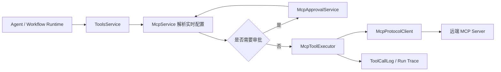
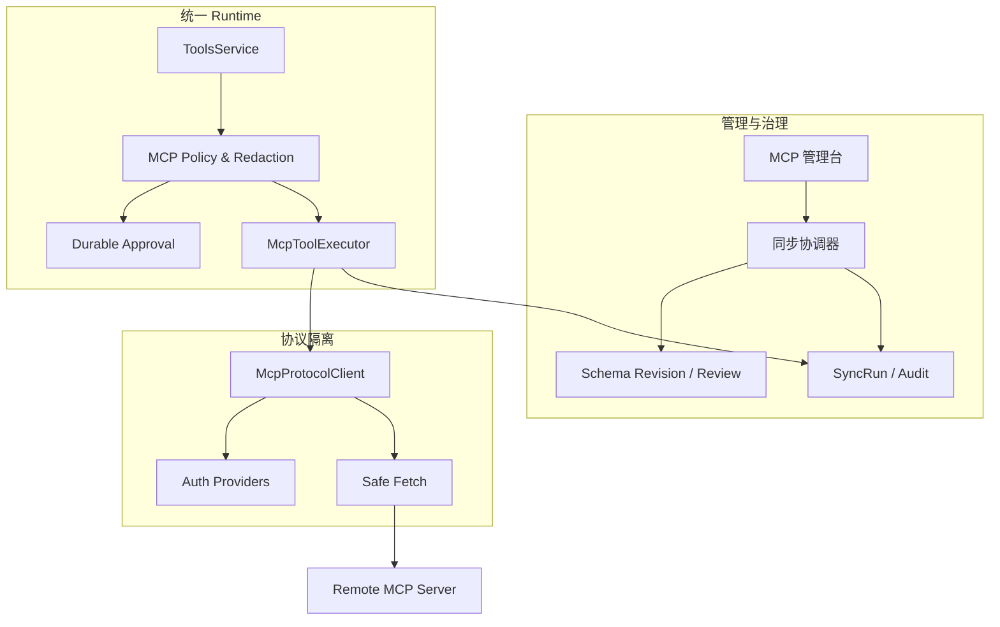

# Mia MCP 后续完善技术方案

## 1. 文档信息

- 文档状态：待实施
- 方案版本：V1.0
- 编写日期：2026-08-13
- 适用范围：Mia 作为 MCP Host/Client 连接外部 MCP Server
- 依据：当前仓库代码、Prisma 数据模型、管理端页面和现有测试
- 关联文档：[Mia MCP Client 技术方案](./mcp-client-technical-design.md)

## 2. 结论

Mia 当前 MCP 已经不是概念验证，而是具备基本生产闭环：管理员可以连接 Streamable HTTP Server，使用固定凭据、Client Credentials 或 OAuth 鉴权，发现 Tool、Resource 和 Prompt；Tool 可以进入 Agent、Workflow、Tool Search、Run Trace 和人工审批链路。

下一阶段不应优先扩展 Sampling、Elicitation、stdio 或 MCP 市场，而应先把现有能力从“可用”提升到“可治理、可排障、故障可恢复”。建议按以下顺序实施：

1. **P0 安全与变更治理**：调用日志脱敏、Schema 变更隔离、异常 Tool 局部失败、输出 Schema 校验。
2. **P1 稳定性与可观测性**：运行时健康回写、同步互斥、可配置巡检、同步历史 UI、Tool 测试台。
3. **P1 审批与鉴权韧性**：审批跨重启恢复、OAuth 状态清理和远端撤销、错误分类标准化。
4. **P2 协议能力补充**：Resource Template 参数化、Resources/Prompts 变化通知、长任务 Tasks 评估。
5. **P3 独立产品方向**：按用户 OAuth、受控 stdio、Mia 作为 MCP Server。

## 3. 当前实现盘点

### 3.1 已完成能力

| 领域 | 当前能力 | 主要实现位置 |
| --- | --- | --- |
| Transport | Streamable HTTP、协议自动协商、2025-era 回退 | `clients/mcp-protocol.client.ts` |
| 鉴权 | None、Bearer、API Key、Client Credentials、OAuth + PKCE | `mcp-protocol-client.factory.ts`、`mcp-oauth.manager.ts` |
| 网络安全 | 公网 HTTPS、私网显式授权、DNS 与重定向逐跳检查 | `mcp-network-policy.ts` |
| Tool 发现 | 自动分页、Schema 快照、稳定 Runtime ID、新 Tool 默认停用 | `mcp.service.ts` |
| Tool 执行 | 参数校验、超时、取消、并发限制、连接阶段重试、输出裁剪 | `mcp-tool.executor.ts` |
| Runtime | Agent、Workflow 和统一 ToolsService 复用同一执行入口 | `tools.service.ts`、`agent-runtime.service.ts` |
| Tool Search | 大量绑定工具时先检索目录再加载候选 Schema | `tools.service.ts` |
| 审批 | CONFIRM 模式、Chat SSE 确认、一次性消费、防参数替换 | `mcp-approval.service.ts` |
| Resources | 目录、文本预览、管理员显式导入知识库 | `mcp.service.ts`、`McpResourcesDrawer.tsx` |
| Prompts | 目录、参数预览、导入停用 Skill 草稿 | `mcp.service.ts`、`McpPromptsDrawer.tsx` |
| 运维 | 手工连接测试、手工同步、15 分钟巡检、tools/list_changed 防抖 | `mcp.service.ts` |
| 日志 | 统一 ToolCallLog、Run Step、错误类型和耗时 | `tools.service.ts`、日志页面 |

### 3.2 当前运行链路



架构边界总体正确：Chat 和 Workflow 不依赖 MCP SDK，MCP 通过 ToolsService 接入统一 Runtime。后续优化应保持该依赖方向，不另建 MCP 专用 Agent Loop。

## 4. 主要缺口与风险

### 4.1 P0：MCP 输入与输出缺少专用脱敏

当前 `ToolsService.sanitizeToolInput` 主要处理预配置 HTTP Tool；MCP Tool 的输入通常原样写入 `ToolCallLog`。远端结果和错误消息也只做长度裁剪，没有按 Server/Tool 配置敏感字段。

风险：

- 密码、Token、手机号、身份证、工单隐私等业务参数进入数据库和管理页面。
- 远端 Server 将 Secret 写进错误消息时，可能进入健康状态、同步记录和日志。
- 人工审批虽然加密保存参数，但执行完成后的通用 ToolCallLog 仍可能保留明文。

方案：

1. 在 `McpServerTool` 增加 `sensitiveInputPaths JsonB`、`sensitiveOutputPaths JsonB`。
2. 支持 JSON Pointer 或受限点路径，例如 `/password`、`/customer/mobile`、`items[*].token`。
3. `McpService` 暴露 `sanitizeRuntimeInput` 和 `sanitizeRuntimeOutput`，ToolsService 只调用模块公开方法，不查询 MCP 表。
4. 默认按字段名启发式屏蔽 `password/token/secret/apiKey/authorization/cookie`。
5. 所有远端错误先经过统一 `McpErrorSanitizer`，再写 Server、SyncRun、ToolCallLog 和 SSE。
6. 日志只保存裁剪后的脱敏结构；完整原始结果不持久化。

验收：测试 Server 返回嵌套 Secret 后，API、应用日志、ToolCallLog、Run Trace 和 Chat 均搜索不到原值。

### 4.2 P0：Schema 变化会直接覆盖已启用 Tool

当前同步保持稳定 Tool ID，但远端 Schema Hash 变化后会直接更新本地快照，已启用状态保持不变。若远端增加必填参数、改变字段含义或扩大工具能力，现有 Agent 会在管理员未复核的情况下使用新定义。

方案：

1. 新增 `McpToolSchemaRevision`，保存每次不同 Hash 的不可变快照。
2. `McpServerTool` 增加：
   - `activeRevisionId`：当前 Runtime 使用版本；
   - `latestRevisionId`：最近发现版本；
   - `schemaReviewStatus`：`CURRENT/PENDING/REJECTED`；
   - `schemaChangeType`：`NONE/NON_BREAKING/BREAKING/UNKNOWN`。
3. 同步发现变化时先写 Revision，不立即替换 `activeRevisionId`。
4. 自动比较 required、属性类型、枚举、additionalProperties 和描述变化：
   - 仅标题或描述变化可标记 `NON_BREAKING`，仍建议管理员确认；
   - 新增必填、删字段、改类型、扩大权限语义一律 `BREAKING/UNKNOWN`；
   - 高风险 Tool 的任何变化都进入 `PENDING`。
5. 管理端展示字段级 Diff，提供“接受新版本”和“继续使用旧版本”。
6. 远端 Tool 已删除时继续阻止新调用，但保留 Revision 与历史 Trace。

验收：已启用 Tool 发生破坏性变化后，Runtime 仍使用原已批准快照或明确阻止调用，不会静默采用新 Schema。

### 4.3 P0：一个异常 Tool 会导致整个 Server 同步失败

当前 `validateDiscoveredTools` 对全集校验；任意工具名重复、名称非法或 inputSchema 异常都会使整次同步失败，其他正常 Tool 无法更新。

方案：

1. 将发现结果拆为 `validTools` 与 `invalidTools`。
2. 新增 `McpDiscoveredToolIssue` 或在 SyncRun 增加结构化 `issues JsonB`，记录远程名、错误码和脱敏摘要。
3. 只要连接和 `tools/list` 完整成功，正常 Tool 仍可事务提交。
4. 非法 Tool 不进入 Runtime；同名冲突的所有冲突项进入隔离区，避免选择不确定版本。
5. 增加每 Server 最大工具数，默认 100、硬上限 500；超限时同步失败且保留旧快照。
6. UI 显示“同步完成但有 N 个工具被隔离”。

验收：包含 1 个非法 Tool 和 9 个正常 Tool 的 Server 可以同步 9 个正常 Tool，且异常原因可见。

### 4.4 P0：没有校验 structuredContent 的 outputSchema

执行器优先返回 `structuredContent`，但当前只校验输入 Schema，没有用远端 `outputSchema` 校验输出。错误结构可能继续进入模型或 Workflow，造成字段误读。

方案：

1. 将 `outputSchema` 和其 Hash 加入 `McpRuntimeToolConfig`。
2. 使用独立 AJV 缓存编译输出校验器。
3. 校验失败返回 `mcp_invalid_output`，日志只记录结构摘要和校验错误。
4. 可配置兼容策略：默认 `strict`；迁移期可选 `warn_and_text`，但高风险 Tool 强制 strict。
5. 不信任远端 annotations 来放宽校验。

### 4.5 P1：运行时调用结果没有完整反哺健康状态

Server 健康状态主要由“测试连接”和“同步工具”更新。实际 Tool 调用出现连续 401、超时或 5xx 时，管理页可能仍显示健康；固定 Bearer/API Key 失效后也不能及时进入 `AUTH_REQUIRED`。

方案：

1. MCP Executor 只返回标准错误，不直接查库。
2. ToolsService 调用 `McpService.recordRuntimeOutcome(dto)` 弱依赖回写：
   - 成功：更新时间、清零连续失败；
   - 401/403：立即 `AUTH_REQUIRED`；
   - 网络/超时/5xx：累计失败；
   - Tool `isError=true`：属于业务失败，不降低连接健康。
3. `McpServer` 增加 `consecutiveFailures`、`lastRuntimeSuccessAt`、`lastRuntimeFailureAt`。
4. 建立轻量状态机：连续 3 次连接类失败进入 `DEGRADED`，5 次进入 `UNAVAILABLE`；一次成功可回到 `HEALTHY`。
5. 状态回写失败不能影响 Tool 主调用结果。

### 4.6 P1：巡检与通知依赖单进程内存

当前巡检使用固定 15 分钟 `setInterval`，同步互斥仅在单实例内成立；多实例部署时每个实例都会巡检。`tools/list_changed` 只有短连接存活期间能收到，连接关闭后主要依赖周期同步。

Mia 当前是单机部署，可以先保持模块化单体，但需要消除重叠和不可配置问题：

1. 将巡检周期、启动抖动和每轮最大 Server 数放入统一配置。
2. 在数据库使用 PostgreSQL advisory lock 或巡检租约，保证同一 Server 同时只有一个 SyncRun。
3. 手工同步、通知同步和定时同步共用同一互斥入口。
4. 应用启动时将遗留 `RUNNING` 且超时的 SyncRun 标记为 FAILED。
5. 分 Server 加随机抖动，避免所有远端同时收到请求。
6. 暂不建立常驻连接池；当真实监控显示建连耗时占 Tool P95 超过 20% 时，再增加带 TTL 的受控连接管理器。

### 4.7 P1：审批等待不能跨进程或重启恢复

审批记录持久化在数据库，但 `waitForDecision` 使用进程内 Map 唤醒。服务重启或未来多实例时，审批按钮可以更新数据库，却无法唤醒原等待请求。

方案：

1. 保留数据库作为唯一事实源。
2. 单机版本采用短轮询 + AbortSignal，每 500ms 查询一次状态，进程内 waiter 只作为低延迟优化。
3. Runtime Step 保存 approvalId，并允许客户端重新连接后读取 Run 当前状态。
4. 启动时批量过期超时 PENDING 审批。
5. 如果未来多实例，再把通知替换为 PostgreSQL LISTEN/NOTIFY；不提前引入 Redis。

### 4.8 P1：管理端缺少排障和变更治理入口

虽然后端已有 SyncRun API，但当前页面没有同步历史；Tool Drawer 也没有 Schema 查看、变更 Diff、审批策略、测试调用和绑定影响范围。

建议补齐：

- Server 详情抽屉：Capabilities、协议版本、最近错误、最近运行成功、连续失败数。
- 同步历史抽屉：触发来源、耗时、工具数、变化数、隔离数和错误分类。
- Tool 详情：Input/Output Schema、annotations、Revision Diff、风险等级、审批策略。
- Tool 测试台：根据 JSON Schema 生成基础表单，同时允许 JSON 编辑；必须复用正式执行、安全和日志链路。
- 影响分析：展示哪些 Agent 和 Workflow Version 绑定了该 Tool。
- 日志快捷入口：自动带 `source=mcp`、Server 和 Tool 过滤条件。

对应 API：

```text
GET  /api/v1/mcp/servers/:id/sync-runs
GET  /api/v1/mcp/servers/:id/tools/:toolId/revisions
POST /api/v1/mcp/servers/:id/tools/:toolId/revisions/:revisionId/accept
POST /api/v1/mcp/servers/:id/tools/:toolId/test
GET  /api/v1/tools/:toolId/bindings
```

Tool 测试默认不支持交互审批；CONFIRM Tool 需要管理员在测试弹窗再次明确确认。
绑定影响分析由上层管理用例调用 Agents/Workflows 对外 Service 聚合，MCP 模块不能跨模块直接查询 Agent 或 Workflow 表。

### 4.9 P1：错误分类依赖字符串正则

当前部分错误通过匹配 `401/403/ECONN/timeout` 文本分类。SDK 或远端错误文案变化后容易误判，且同步记录大量使用通用 `DISCOVERY_FAILED`。

方案：

1. 在协议隔离层定义 `McpClientError`，字段包括 `category/httpStatus/retryable/phase/safeMessage/causeCode`。
2. 错误阶段固定为 `connect/initialize/list/call/read/get_prompt/oauth`。
3. Service 和 Executor 只消费结构化错误，不再重复字符串匹配。
4. 对外错误码稳定使用：
   - `mcp_auth_required`
   - `mcp_network_error`
   - `mcp_connect_timeout`
   - `mcp_protocol_error`
   - `mcp_invalid_arguments`
   - `mcp_invalid_output`
   - `mcp_tool_error`
   - `mcp_output_too_large`
   - `mcp_canceled`

### 4.10 P1：OAuth 生命周期仍有运维缺口

当前本地撤销会立即失效，但没有调用远端 revocation endpoint；过期 state、PKCE 和历史 Token 状态也缺少周期清理入口。

方案：

1. Discovery 支持 revocation endpoint 时，尽力撤销 refresh/access token；失败只告警，不恢复本地授权。
2. 定时清理过期 state、verifier 和 discovery 临时数据。
3. 管理页展示 Scope、授权时间、Token 到期时间和“需重新授权”原因，不返回 Token。
4. 配置更新导致 endpoint/client/scope 改变时，明确标记旧授权失效。
5. 增加 OAuth 回调失败页，避免第三方错误只返回通用 API JSON。

## 5. P2 协议能力补充

### 5.1 Resource Template 参数化

当前只展示 URI Template，不支持填写参数和展开。建议复用 Prompt 参数表单：管理员填写模板变量，客户端在本地严格展开 URI，再通过 `resources/read` 读取。禁止 Mia 直接对展开后的 URI 发 HTTP 请求。

### 5.2 Resources 与 Prompts 变化通知

在 SDK 支持稳定后，增加 resources/prompts 的 list_changed 监听与目录刷新提示。目录仍以实时读取为主，不需要把全部正文同步进数据库。

### 5.3 MCP Tasks / 长任务评估

当前 `tools/call` 适合几十秒内完成的 Tool。若实际 Server 出现构建、数据导出等分钟级任务，再设计 Tasks：

- Runtime 不长时间占用 SSE 和并发槽位；
- 保存远端 taskId、状态和过期时间；
- 轮询支持取消、超时和恢复；
- ToolCallLog 与 Run Step 维持同一 requestId；
- 不在确认真实需求前自行模拟异步任务协议。

### 5.4 暂不实现的协议能力

| 能力 | 决策 | 原因 |
| --- | --- | --- |
| Sampling | 暂不实现 | 允许远端反向触发模型调用，成本和权限边界复杂 |
| Elicitation | 暂不实现 | 与现有 Chat 审批/表单状态机重叠，需要独立交互安全方案 |
| Roots | 暂不实现 | Mia 当前没有把本地文件系统暴露给远端的业务需求 |
| stdio | P3 评估 | 服务端执行进程会扩大任意代码执行风险 |
| MCP Apps/UI | 暂不实现 | 远端 UI 沙箱、来源信任和 CSP 尚无产品需求 |

## 6. P3 独立方向

### 6.1 按用户 OAuth

只有当同一个 MCP Server 必须以成员个人身份访问数据时才实施。新增 `McpUserAuthorization`，缓存键必须包含 `serverId + userId + credentialVersion`。公开 Widget、Service API 和 Workflow 不能隐式借用成员 Token。

### 6.2 受控 stdio

不允许管理员填写任意 shell。仅能选择平台预置镜像或命令清单，在独立 Worker/容器中运行，并设置只读文件系统、无特权用户、CPU/内存/进程/网络限制和完整审计。

### 6.3 Mia 作为 MCP Server

这是对外发布能力，应另建方案。只暴露已发布且版本固定的 Workflow/Agent，并独立处理 OAuth Scope、调用方身份、限流、幂等、审计和版本回滚，不能复用 MCP Client 的 Server 配置表。

## 7. 目标架构



模块职责：

- `mcp.service.ts`：Server、Tool、Revision、同步和 Runtime 配置用例。
- `mcp-sync.service.ts`：同步互斥、部分成功、变化分类和 SyncRun；从超大的 `mcp.service.ts` 拆出。
- `mcp-policy.service.ts`：风险、审批、输入输出脱敏和健康结果回写。
- `mcp-tool.executor.ts`：参数/输出校验、并发、超时和协议调用，不访问数据库。
- `clients/`：SDK、Transport、OAuth 和结构化错误适配。
- `ToolsService`：统一调度与通用日志，不理解 MCP 表结构。

## 8. 数据模型调整

### 8.1 `mcp_server_tools`

新增建议字段：

```text
active_revision_id        UUID nullable
latest_revision_id        UUID nullable
schema_review_status      CURRENT | PENDING | REJECTED
schema_change_type        NONE | NON_BREAKING | BREAKING | UNKNOWN
sensitive_input_paths     JsonB default []
sensitive_output_paths    JsonB default []
```

### 8.2 `mcp_tool_schema_revisions`

```text
id                        UUID
tool_id                   UUID
schema_hash               String
title                     String nullable
description               Text
input_schema              JsonB
output_schema             JsonB nullable
annotations               JsonB nullable
change_type               Enum
discovered_at             Timestamptz
accepted_at               Timestamptz nullable
accepted_by_user_id       UUID nullable
```

唯一约束：`tool_id + schema_hash`。

### 8.3 `mcp_servers`

新增建议字段：

```text
consecutive_failures      Int default 0
last_runtime_success_at   Timestamptz nullable
last_runtime_failure_at   Timestamptz nullable
```

### 8.4 `mcp_sync_runs`

新增建议字段：

```text
valid_tool_count          Int default 0
invalid_tool_count        Int default 0
unavailable_tool_count    Int default 0
issues                    JsonB nullable
lock_owner                String nullable
```

issues 必须限制条数和单条长度，不保存完整远端响应。

## 9. 配置项

统一放入 `core/config`，不在 Service 写死环境变量：

```text
MCP_PATROL_ENABLED=true
MCP_PATROL_INTERVAL_SECONDS=900
MCP_PATROL_JITTER_SECONDS=60
MCP_SYNC_STALE_SECONDS=300
MCP_MAX_TOOLS_PER_SERVER=100
MCP_MAX_SCHEMA_BYTES=262144
MCP_APPROVAL_TTL_SECONDS=300
MCP_APPROVAL_POLL_INTERVAL_MS=500
MCP_RUNTIME_FAILURE_DEGRADED_THRESHOLD=3
MCP_RUNTIME_FAILURE_UNAVAILABLE_THRESHOLD=5
```

## 10. 分阶段实施

### Phase A：安全基线（P0）

1. MCP 输入、输出、错误统一脱敏。
2. outputSchema 校验。
3. Tool 数量、Schema 字节和描述长度硬限制。
4. 增加敏感字段和超限测试。

验收：日志无敏感信息，恶意或超大 Schema/Result 无法拖垮 Runtime。

### Phase B：Schema 治理与同步韧性（P0）

1. Schema Revision 数据模型和迁移。
2. 变化分类、待审核状态和管理员接受流程。
3. 异常 Tool 局部隔离。
4. 同步数据库锁、遗留 Run 清理和结构化 issues。

验收：远端变化不会静默扩大已启用 Tool 权限；部分坏数据不影响正常 Tool。

### Phase C：可观测性与管理体验（P1）

1. Runtime outcome 回写健康状态。
2. 同步历史、Tool 详情、Schema Diff、影响分析和 Tool 测试台。
3. 日志增加 `source=mcp`、Server、Tool、errorType 筛选。
4. 增加 Server 维度成功率、P95、超时和截断统计。

验收：管理员可从 MCP 页面完成配置、变更审核、测试和故障定位。

### Phase D：审批与 OAuth 韧性（P1）

1. 审批轮询恢复和启动过期清理。
2. OAuth 远端撤销、临时状态清理、授权详情和失败页。
3. 协议结构化错误统一。

验收：重启不会留下永久 PENDING；OAuth 失效原因可诊断，错误码稳定。

### Phase E：按需求扩展协议（P2/P3）

仅在出现真实业务需求后选择 Resource Template、Tasks、按用户 OAuth、stdio 或 Mia MCP Server，不捆绑发布。

## 11. 测试策略

### 11.1 单元测试

- JSON 路径脱敏、默认敏感字段和错误消息脱敏。
- Schema Diff：新增必填、删字段、改类型、枚举变化、描述变化。
- outputSchema 成功与失败。
- 单个非法 Tool 隔离、重复名隔离、工具数和 Schema 大小限制。
- 健康状态转换及业务错误不降级。
- 审批重启恢复和过期清理。
- 结构化错误分类。

### 11.2 集成测试

使用内存 MCP Server 覆盖：

- 10 个正常 Tool + 1 个非法 Tool；
- 同步期间 Schema 改变；
- 401、403、429、500、超时、断连和 `isError=true`；
- structuredContent 与 outputSchema 不一致；
- 结果或错误中包含 Secret；
- list_changed 通知风暴；
- 两个同步请求同时到达；
- 审批期间模拟服务重启。

### 11.3 前端测试

- Schema Diff 正确显示并要求确认。
- Secret 不回显，敏感路径配置正确提交。
- Tool 测试失败显示稳定错误而非原始异常堆栈。
- 同步部分成功、隔离项和历史记录可理解。
- MCP 日志快捷筛选正确。

### 11.4 回归命令

所有命令使用 Node.js 22：

```bash
npm run prisma:generate
npm --prefix backend exec -- prisma validate
npm run typecheck
npm run lint
npm --prefix backend test
npm run build
```

## 12. 发布与回滚

1. 先发布可向后兼容的数据表和 nullable 字段。
2. 后端双读：无 Revision 的旧 Tool 临时使用当前快照，并后台生成首个 Revision。
3. 完成回填后再启用 Schema Review；默认不自动阻断旧 Tool。
4. 脱敏策略先以“记录命中但不改变业务结果”观察，再切换为强制。
5. 管理端新入口晚于后端发布，保证旧前端仍可操作。
6. 回滚时保留 Revision、SyncRun 和审计数据；Runtime 可切回 `activeRevisionId` 对应快照。

## 13. 验收指标

- MCP ToolCallLog 敏感数据泄漏测试通过率 100%。
- Schema 破坏性变化未经接受时自动生效率为 0。
- 单个非法 Tool 导致整个 Server 同步失败的比例为 0。
- 运行时 401/403 后 1 分钟内 Server 显示 `AUTH_REQUIRED`。
- 同一 Server 并发 SyncRun 数不超过 1。
- 所有 MCP 错误都有稳定 errorType、phase 和 requestId。
- 管理员从 MCP 页面定位一次失败调用不超过 3 次跳转。
- 后端 MCP 与相关 Runtime 测试全部通过。

## 14. 实施优先级清单

| 优先级 | 工作项 | 预估复杂度 | 是否需要迁移 |
| --- | --- | --- | --- |
| P0 | MCP 输入/输出/错误脱敏 | 中 | 是 |
| P0 | outputSchema 校验 | 小 | 否或小 |
| P0 | Schema Revision 与审核 | 大 | 是 |
| P0 | 异常 Tool 局部隔离及容量限制 | 中 | 建议 |
| P1 | Runtime 健康回写 | 中 | 是 |
| P1 | 同步互斥、巡检配置和遗留 Run 清理 | 中 | 可选 |
| P1 | 同步历史、Schema Diff、Tool 测试台 | 大 | 否 |
| P1 | 审批跨重启恢复 | 中 | 否 |
| P1 | 结构化错误与 OAuth 生命周期 | 中 | 否 |
| P2 | Resource Template 参数化 | 中 | 否 |
| P2 | Resources/Prompts 变化通知 | 中 | 否 |
| P2 | Tasks 评估 | 大 | 待定 |
| P3 | 按用户 OAuth | 大 | 是 |
| P3 | 受控 stdio | 很大 | 待定 |
| P3 | Mia MCP Server | 很大 | 独立方案 |

最终建议：先执行 Phase A 和 Phase B。它们直接解决数据泄漏、权限静默扩大和同步脆弱性，是当前 MCP 从内部可用走向稳定生产使用的必要条件；协议新能力应排在治理闭环之后。
