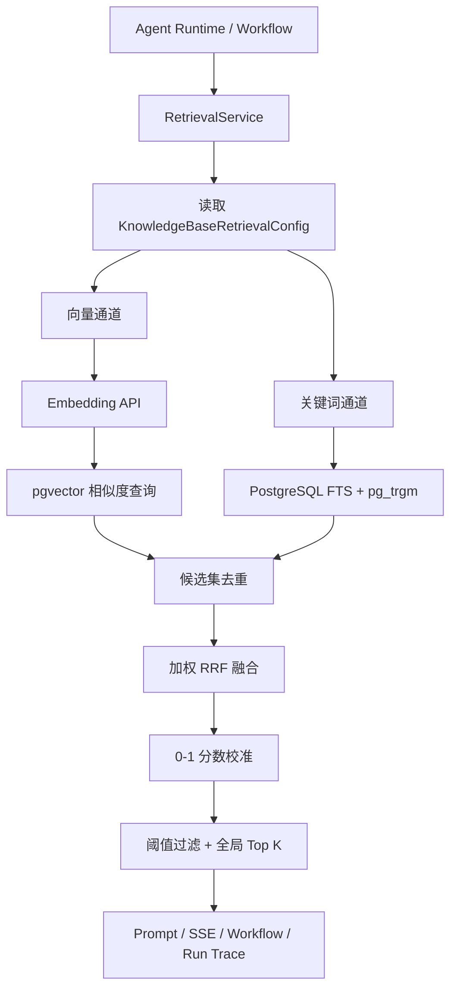

# RAG 混合双检索技术设计

## 1. 文档定位

本文描述 Mia 已实现的 RAG 混合双检索链路。当前方案以 PostgreSQL + pgvector 为基础，同时执行：

1. 向量语义检索：召回语义相近但用词不同的 Chunk。
2. 关键词检索：召回错误码、产品名、路径、版本号和中文连续文本等精确信息。
3. 加权 RRF 融合：按排名融合两路候选，统一去重、阈值过滤和 Top K 截断。

本方案已经接入 Agent Runtime、Chat SSE、Workflow Retrieval 节点和 Run Trace，不是独立的演示接口。

实现状态：已完成，后端全量测试 `165/165` 通过。

## 2. 背景与问题

仅使用向量检索存在以下问题：

- 错误码、订单号、类名、接口路径等低语义高精度文本容易漏召回。
- Embedding 服务不可用时，整个 RAG 链路无法提供资料。
- 不同 Embedding 模型的相似度分数不适合与词法分数直接相加。
- 单纯扩大 Vector Top K 会增加无关上下文，不能解决精确关键词召回问题。

仅使用关键词检索同样不足：

- 无法稳定处理同义表达和自然语言改写。
- 用户问题与文档用词不一致时召回率低。
- 中文分词依赖特定扩展，部署兼容性受限。

因此 Mia 使用“语义召回 + 词法召回 + 排名融合”，在不增加额外搜索服务的情况下提升召回率和故障韧性。

## 3. 目标与非目标

### 3.1 目标

1. 向量和关键词通道并行执行，避免串行增加首 Token 延迟。
2. 支持中文、英文、错误码、路径和无空格标识符。
3. 不直接混加不同通道的原始分数。
4. Chunk 全局去重，优先提升双路共同命中的结果。
5. 保持原有 `scoreThreshold` 和 UI 百分比的 `0-1` 语义。
6. 单通道临时故障时自动降级，双通道故障时明确失败。
7. 检索必须遵守 Workspace、知识库授权和文档索引状态边界。
8. Run Trace 可以判断本次检索是否降级、各通道召回多少候选。

### 3.2 非目标

- 当前不实现远程 Rerank 模型调用。
- 当前不将 PostgreSQL 词法排序描述为 BM25；实现使用 `ts_rank_cd`、trigram 相似度和精确短语命中。
- 当前不引入 Elasticsearch、OpenSearch、Qdrant Sparse Vector 或独立搜索集群。
- 当前不做查询改写、多查询扩展和 HyDE。
- 当前不修改知识库切分策略、相邻 Chunk 合并和 RAG Token 总预算。

## 4. 总体架构



模块调用方向：

```text
agent_runtime / workflow_runtime
  -> retrieval.service
       -> knowledge.service
       -> model_providers.service
       -> VectorStore
```

`RetrievalService` 不直接查询 Knowledge Chunk 表。关键词 SQL 归属 `KnowledgeService`，符合 `retrieval -> knowledge` 的既有模块边界。

## 5. 检索执行流程

### 5.1 输入归一化

输入 DTO：

```ts
type RetrieveKnowledgeContextRequest = {
  query: string;
  knowledgeBaseIds: string[];
  topK?: number;
  scoreThreshold?: number;
  signal?: AbortSignal;
};
```

处理规则：

- `query` 去除首尾空白。
- 空查询或空知识库集合直接返回空结果。
- `topK` 默认值为 `5`，最大值为 `12`。
- `scoreThreshold` 仅接受 `0-1` 的有限数字；异常值忽略。
- Knowledge Service 只返回当前可见、启用且未删除的知识库运行配置。
- 所有知识库必须属于同一 Workspace。

### 5.2 扩大候选集

最终返回数量不能直接作为每路召回数量，否则融合阶段没有足够候选。

```text
candidateLimit = clamp(topK × 4, 20, 60)
```

例如 `topK = 5` 时，向量和关键词通道分别最多召回 `20` 个候选，融合后再截断为 `5` 个。

### 5.3 并行召回

关键词通道不依赖查询向量，因此使用 `Promise.allSettled` 与向量通道并行执行：

```text
读取知识库运行配置
  -> 同时开始：
       A. 生成 Query Embedding -> pgvector 查询
       B. FTS + trigram 查询
  -> 收集两路成功或失败状态
```

使用 `allSettled` 而不是 `Promise.all`，目的是保留单通道失败时的降级能力。

## 6. 向量语义通道

### 6.1 多 Embedding 空间隔离

不同 Embedding 模型即使维度相同，也不属于同一个向量空间。检索前按照 `embeddingModelConfigId` 分组：

```text
Embedding Model A
  -> Knowledge Base 1
  -> Knowledge Base 2

Embedding Model B
  -> Knowledge Base 3
```

每组单独生成 Query Embedding，并且只查询使用该模型构建的向量索引。

### 6.2 维度校验

模型返回的向量长度必须与知识库锁定的 `embeddingDimension` 一致。维度不一致属于配置错误，不允许降级掩盖：

```text
知识库要求 1536 维
模型实际返回 1024 维
-> 抛出 RetrievalConfigurationError
-> 提示检查或重建知识库 Embedding 配置
```

### 6.3 数据过滤

pgvector 查询必须同时满足：

- Chunk、Document、Embedding 属于同一 Workspace。
- Knowledge Base 在本次授权集合中。
- Embedding 模型配置一致。
- Chunk 和 Document 未软删除。
- Document 状态为 `indexed`。

向量相似度使用：

```sql
1 - (embedding <=> query_embedding)
```

## 7. 关键词通道

### 7.1 检索组成

关键词通道由三部分构成：

| 子策略         | 主要用途                           | 分数         |
| -------------- | ---------------------------------- | ------------ |
| PostgreSQL FTS | 英文单词、路径分段、自然语言关键词 | `ts_rank_cd` |
| `pg_trgm`      | 中文连续文本、模糊词、无空格标识符 | `similarity` |
| 精确子串       | 错误码、版本号、完整短语           | 命中为 `1.0` |

单条 Chunk 的关键词分数：

```text
keywordScore = clamp(
  max(ftsScore, trigramScore, exactPhraseScore),
  0,
  1
)
```

### 7.2 为什么不只使用 FTS

PostgreSQL `simple` 字典不会提供完整中文分词。为了不强制腾讯云或本地 PostgreSQL 安装 `zhparser`，方案增加 `pg_trgm`：

- FTS 负责英文和被标点切开的词元。
- trigram 负责中文连续字符和模糊匹配。
- 精确子串保证错误码、接口名等强信号获得最高分。

该组合部署依赖较小，适合 Mia 当前 PostgreSQL 单体架构。

### 7.3 查询约束

- 查询文本最大长度：`1000` 字符。
- 候选数量最大值：`100`，Retrieval 当前实际最多请求 `60`。
- 数据库 `statement_timeout`：`2000ms`。
- 超时通过事务内 `set_config(..., true)` 设置，只影响本次查询。
- 仅查询 `status = indexed` 且未删除的 Document。
- SQL 参数全部参数化；动态内容不拼接为表名或 SQL 片段。

## 8. 数据库索引

迁移文件：

```text
backend/prisma/migrations/
  20260825000100_add_hybrid_retrieval_indexes/migration.sql
```

迁移启用：

```sql
CREATE EXTENSION IF NOT EXISTS pg_trgm;
```

并创建三个索引：

```sql
-- 英文与结构化关键词全文索引
GIN (to_tsvector('simple', content))

-- 中文连续文本与模糊匹配索引
GIN (lower(content) gin_trgm_ops)

-- Workspace + Knowledge Base 候选范围索引
(workspace_id, knowledge_base_id) WHERE deleted_at IS NULL
```

生产部署前必须确认腾讯云 PostgreSQL 实例允许创建 `pg_trgm` 扩展。若数据库账号没有扩展权限，需要由实例管理员预先启用。

## 9. RRF 融合与分数校准

### 9.1 为什么使用 RRF

向量相似度和关键词相关度来自不同计算空间，直接进行如下相加没有稳定语义：

```text
0.82 cosine + 0.43 text rank
```

Reciprocal Rank Fusion 只依赖候选在各自通道中的排名，减少分数尺度差异影响。

### 9.2 加权 RRF

当前固定参数：

```text
RRF K = 60
vectorWeight = 0.65
keywordWeight = 0.35
```

候选 `d` 的 RRF 分数：

```text
rrf(d) = 0.65 / (60 + vectorRank(d))
       + 0.35 / (60 + keywordRank(d))
```

不存在于某个通道的候选，该通道贡献为 `0`。同一个 `chunkId` 在融合前后只保留一条记录。

### 9.3 对外分数校准

原始 RRF 数值很小，不能直接复用现有 `scoreThreshold`。系统先把 RRF 归一化为 `fusionScore`，再结合通道置信度：

```text
confidence = max(vectorScore, keywordScore)

score = clamp(
  confidence × 0.75 + fusionScore × 0.25,
  0,
  1
)
```

这样可以同时满足：

- 双路共同命中的 Chunk 获得排名提升。
- 精确关键词单路命中仍可以通过较高阈值。
- 原有 UI 继续显示 `0-100%` 相关度。
- 原有 Workflow `scoreThreshold` 无需更改协议。

最终排序规则：

1. `score` 降序。
2. `fusionScore` 降序。
3. `chunkId` 字典序，保证同分结果稳定。

## 10. 降级与错误策略

| 场景                           | 行为                                  |
| ------------------------------ | ------------------------------------- |
| 向量成功、关键词成功           | 正常双路融合                          |
| Embedding 或向量查询临时失败   | 降级为关键词结果                      |
| 关键词查询超时或数据库通道失败 | 降级为向量结果                        |
| 两路均失败                     | 抛出“向量检索和关键词检索均失败”      |
| Embedding 维度错误             | 立即失败，不允许降级掩盖配置问题      |
| 跨 Workspace 配置              | 立即失败                              |
| 用户取消                       | 抛出 `AbortError`，停止后续召回和融合 |

降级不等于静默忽略。每次检索都会在 `diagnostics.degradedChannels` 中记录失败通道。

## 11. 返回数据契约

每条来源在原有字段上增加可选的混合检索信息：

```ts
type RetrievalSource = {
  knowledgeBaseId: string;
  documentId: string;
  documentName: string;
  chunkId: string;
  chunkIndex: number;
  content: string;
  score: number;
  vectorScore?: number;
  keywordScore?: number;
  fusionScore?: number;
  matchedBy?: Array<"vector" | "keyword">;
};
```

检索级诊断信息：

```ts
type RetrievalDiagnostics = {
  strategy: "hybrid_rrf";
  vectorCandidateCount: number;
  keywordCandidateCount: number;
  fusedCandidateCount: number;
  degradedChannels: Array<"vector" | "keyword">;
};
```

新增字段均为可选字段，确保旧的 Chat、SSE 和 Workflow 消费方保持兼容。

## 12. 运行追踪与可观测性

Agent Runtime 的 Retrieval Step 输出包含：

- 查询耗时 `elapsedMs`。
- 最终 Chunk 数量。
- 向量候选数。
- 关键词候选数。
- 融合后候选数。
- 降级通道。
- 每个来源的 `matchedBy`。
- `vectorScore`、`keywordScore`、`fusionScore` 和最终 `score`。
- 文档、知识库、Chunk 标识和受限正文预览。

Workflow Retrieval 节点输出额外包含 `diagnostics`，便于后续节点或调试页面判断检索质量。

建议生产告警指标：

```text
retrieval_total
retrieval_latency_ms p50/p95/p99
retrieval_empty_rate
retrieval_degraded_total{channel}
retrieval_both_channels_failed_total
retrieval_vector_candidate_count
retrieval_keyword_candidate_count
retrieval_fused_candidate_count
```

当前这些字段已进入 Run Trace；独立 Prometheus 指标属于后续运维增强。

## 13. 性能与容量预期

Mia 当前目标规模为 20-50 人、SSE 并发 30-50。混合检索的主要成本为：

1. Query Embedding 外部调用。
2. pgvector ANN/距离排序。
3. PostgreSQL FTS/trigram 候选查询。

性能保护：

- 两路并行，关键词查询不等待 Embedding。
- 每路候选集限制在 `20-60`。
- 关键词查询数据库超时为 `2s`。
- 最终 Top K 最大为 `12`。
- GIN 和 Workspace/Knowledge Base 局部索引减少扫描。
- 单路异常时不重复执行已经成功的通道。

数据规模显著增长后，需要通过 `EXPLAIN (ANALYZE, BUFFERS)` 检查：

- FTS 是否使用 `idx_knowledge_chunks_content_fts`。
- trigram 是否使用 `idx_knowledge_chunks_content_trgm`。
- Workspace/Knowledge Base 是否先收窄范围。
- 短关键词的 `strpos` 分支是否产生大范围扫描。

对于 1-2 个字符的高频查询，trigram 索引帮助有限。若该类查询成为主要流量，应增加最小查询长度、元数据精确索引或专用 Sparse/BM25 服务。

## 14. 安全与租户隔离

关键词和向量通道都必须同时过滤：

```text
workspace_id
knowledge_base_id
deleted_at
document.status
```

安全约束：

- Retrieval 只能使用 Knowledge Service 返回的已授权知识库配置。
- Keyword SQL 使用参数绑定，禁止用户输入进入 SQL 结构。
- 不向 Chat 前端暴露数据库错误、SQL 或 Provider Secret。
- Run Trace 只保存受限内容预览，不额外记录完整用户查询之外的敏感配置。
- 跨 Workspace 的知识库集合直接拒绝，不进行部分检索。

## 15. 部署与迁移

### 15.1 部署前检查

1. 确认运行 Node.js 22。
2. 备份 PostgreSQL。
3. 确认数据库账号可以启用或使用 `pg_trgm`。
4. 评估 `knowledge_chunks` 数据量和创建 GIN 索引所需时间、磁盘空间。
5. 在低峰期执行生产迁移。

### 15.2 执行迁移

```bash
npm run prisma:deploy
```

### 15.3 验证索引

```sql
SELECT indexname, indexdef
FROM pg_indexes
WHERE tablename = 'knowledge_chunks'
  AND indexname IN (
    'idx_knowledge_chunks_content_fts',
    'idx_knowledge_chunks_content_trgm',
    'idx_knowledge_chunks_workspace_kb_active'
  );
```

### 15.4 回滚原则

应用代码可先回滚到仅向量检索版本；新增 GIN 索引不会改变 Chunk 数据结构，可以暂时保留。确认不再使用后再择低峰期删除索引：

```sql
DROP INDEX IF EXISTS "idx_knowledge_chunks_content_fts";
DROP INDEX IF EXISTS "idx_knowledge_chunks_content_trgm";
DROP INDEX IF EXISTS "idx_knowledge_chunks_workspace_kb_active";
```

不要自动删除 `pg_trgm` 扩展，因为数据库中的其他功能可能也在使用它。

## 16. 测试与验收

已覆盖的自动化用例：

1. 空知识库直接返回空上下文。
2. 不同 Embedding 模型分组检索。
3. Embedding 维度不匹配返回可读错误。
4. AbortSignal 传递与分数阈值过滤。
5. 双路共同命中的 Chunk 被提升且只保留一次。
6. Embedding 服务失败后降级为关键词结果。
7. 两路同时失败时整体失败。
8. Chat RAG Prompt 注入保持兼容。
9. Workflow Retrieval 输出保持兼容。

自动验证命令：

```bash
npm run typecheck:api
npm run lint
npm --prefix backend test
```

当前结果：

```text
TypeScript typecheck: passed
ESLint: passed
Backend tests: 165/165 passed
```

生产验收建议准备四类查询：

| 查询类型     | 示例                            | 预期                   |
| ------------ | ------------------------------- | ---------------------- |
| 语义改写     | “发布失败应该怎么处理”          | 向量通道主召回         |
| 精确错误码   | `ERR_DEPLOY_042`                | 关键词通道强命中       |
| 中文连续短语 | “灰度发布回滚”                  | trigram 或精确短语命中 |
| 混合问题     | “ERR_DEPLOY_042 为什么发布失败” | 双路共同命中优先       |

验收时在 Run Trace 中确认 `matchedBy`、两路候选数和最终排序符合预期。

## 17. 参数调优建议

当前参数是适合 Mia 规模的初始值，不建议没有评测集时频繁调整。

| 参数         |          当前值 | 调整影响                             |
| ------------ | --------------: | ------------------------------------ |
| `topK`       | 默认 5，最大 12 | 增加会扩大 Prompt 和噪声             |
| 候选倍率     |               4 | 增加可提升融合召回，但提高数据库成本 |
| 每路最小候选 |              20 | 保证小 Top K 时仍有融合空间          |
| 每路最大候选 |              60 | 限制长尾延迟和内存                   |
| RRF K        |              60 | 越大越弱化头部与尾部排名差异         |
| 向量权重     |            0.65 | 提高会更偏语义召回                   |
| 关键词权重   |            0.35 | 提高会更偏精确词法命中               |
| 置信度占比   |            0.75 | 提高会更依赖通道原始分数             |
| 融合占比     |            0.25 | 提高会更奖励多路排名一致性           |
| 关键词超时   |          2000ms | 提高容错但增加请求尾延迟             |

正确调优流程：

```text
构建真实问题集
  -> 标注期望文档/Chunk
  -> 记录 Recall@K、MRR、空召回率、延迟
  -> 单变量调整参数
  -> 对比后再发布
```

## 18. 后续 Rerank 接入

远程 Rerank 应位于混合召回之后、阈值和最终 Top K 之前：

```text
向量 + 关键词扩召回
  -> RRF 融合和去重
  -> 截取 Rerank 候选集
  -> 远程 Rerank
  -> Rerank 阈值
  -> 最终 Top K
```

建议新增统一入口：

```text
retrieval.service
  -> model_providers.service.rerank(...)
       -> model_providers.gateway
            -> RerankProviderClient
```

Rerank 必须补充：

- 独立超时与并发限制。
- 查询和文档数量、单文档长度上限。
- 429/5xx 首次失败重试。
- Rerank 失败回退到 RRF 顺序。
- `rerankScore`、模型、耗时和降级状态 Trace。
- 不把远程 API Key 暴露给 Retrieval 或 Chat。

在远程 Rerank 完成前，当前实现应准确称为“混合双检索 + RRF 融合”，不能将 RRF 描述为模型 Rerank。

## 19. 代码位置

| 能力                     | 文件                                                                                  |
| ------------------------ | ------------------------------------------------------------------------------------- |
| 双路编排、降级、RRF 融合 | `backend/src/modules/retrieval/retrieval.service.ts`                                  |
| Retrieval DTO            | `backend/src/modules/retrieval/dto/retrieval.dto.ts`                                  |
| 关键词检索 DTO           | `backend/src/modules/knowledge/dto/knowledge.dto.ts`                                  |
| FTS/trigram SQL          | `backend/src/modules/knowledge/knowledge.service.ts`                                  |
| pgvector 查询            | `backend/src/modules/knowledge/pgvector-store.ts`                                     |
| 数据库索引迁移           | `backend/prisma/migrations/20260825000100_add_hybrid_retrieval_indexes/migration.sql` |
| Run Trace 接入           | `backend/src/modules/agent_runtime/agent-runtime.service.ts`                          |
| Workflow 输出接入        | `backend/src/modules/workflow_runtime/executors/retrieval.executor.ts`                |
| 单元与回归测试           | `backend/src/modules/retrieval/retrieval.service.spec.ts`                             |
