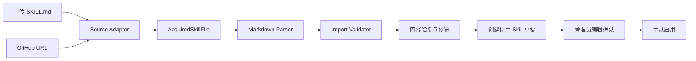

# Skill 外部导入技术方案

> 状态：待实施  
> 支持来源：本地 `SKILL.md` 单文件上传、GitHub 仓库/目录/文件地址  
> 核心约束：外部 Skill 只作为声明式指令资产导入，不执行代码，不自动获得 Tool、Knowledge、Workflow 或网络权限。

## 1. 背景

Mia 当前已实现 Skill 管理 CRUD 和 MCP Prompt 停用草稿导入。现有 `skills` 表包含 `sourceType`、`sourceRef`、`sourceHash` 和 `revision`，`SkillsService.createImportedDraft()` 也已建立“外部来源创建停用快照、不覆盖管理员修改”的基础规则。

下一阶段增加两个入口：

1. 上传单个 `SKILL.md`；
2. 输入 GitHub 地址，由 Mia 下载对应 `SKILL.md`。

本方案借鉴 Dify Plugin 的来源安装、安装前检查、不可变标识、权限提示和版本更新思想，但不引入 Plugin Daemon，也不允许 Skill 作为可执行插件运行。

```text
Dify Plugin：可执行扩展，需要运行时、依赖、资源限制和进程隔离
Mia Skill：声明式指令资产，只解析 Markdown 并注入 Agent 上下文
```

## 2. 目标与非目标

### 2.1 目标

- 支持上传 UTF-8 编码的单个 `SKILL.md`；
- 支持 GitHub 仓库、目录和具体文件地址；
- 两种来源共用解析、校验、哈希和草稿创建逻辑；
- 支持 YAML Front Matter 和普通 Markdown；
- 外部导入始终创建停用草稿；
- 保存内容哈希和可追溯来源；
- GitHub 分支或标签最终固定为 commit SHA；
- GitHub 安装前提供预览，并防止预览后内容被替换；
- 为后续更新检查、差异预览和回滚预留边界；
- 保持 Workspace 隔离和现有乐观锁规则。

### 2.2 非目标

- 不支持 ZIP Skill 包；
- 不下载或执行 `scripts/`；
- 不执行 Markdown 代码块；
- 不安装 `package.json`、`requirements.txt` 等依赖；
- 不递归扫描整个 GitHub 仓库；
- 不实现开放 Skill 市场；
- 不自动启用或绑定 Agent；
- 不自动授予工具、知识库或 Workflow 权限；
- 第一阶段不支持私有 GitHub 仓库。

## 3. 总体架构

上传和 GitHub 下载只在“如何取得文件”上不同。取得文件后进入同一条流水线。



### 3.1 外部内容不可信

导入行为只允许：

- 解码 UTF-8；
- 解析受限 YAML Front Matter；
- 解析 Markdown 标题和正文；
- 计算哈希；
- 保存文本和来源元数据。

导入流程禁止：

- 执行代码、命令或安装脚本；
- 访问 Markdown 中的链接、图片和本地路径；
- 根据文件内容修改 Agent、Tool、Knowledge 或权限配置；
- 根据文件内容发起额外网络请求。

### 3.2 导入始终停用

上传和 GitHub 安装均调用 `SkillsService.createImportedDraft()`，并强制 `enabled=false`。外部请求不能通过参数绕过该规则。

### 3.3 GitHub 两阶段安装

GitHub 分支内容可能在预览后变化，因此采用：

```text
inspect：解析 URL → 固定 commit SHA → 下载 → 校验 → 返回预览和 hash
install：按固定 commit 重新下载 → 校验预期 commit/hash → 创建停用草稿
```

本地文件是一次性确定内容，第一阶段直接创建停用草稿，随后打开现有编辑弹窗确认。

## 4. SKILL.md 规范

### 4.1 推荐格式

```markdown
---
name: code-review
description: 检查代码正确性、安全性和可维护性
version: 1.2.0
author: mia-team
tags:
  - development
  - review
compatibility:
  minimum_mia_version: 0.1.0
---

# Code Review

## When to use

当用户要求审查代码或排查问题时使用。

## Instructions

1. 理解代码目标。
2. 检查正确性、边界条件和异常处理。
3. 检查安全风险。
4. 给出明确修改建议。

## Input guidance

需要提供代码、语言和预期行为。

## Output guidance

按严重级别输出问题和建议。

## Limitations

不要执行不可信代码。
```

### 4.2 Front Matter 字段

| 字段 | 必填 | 规则 | 用途 |
| --- | --- | --- | --- |
| `name` | 否 | 1–80 字符 | Skill 名称 |
| `description` | 否 | 最多 500 字符 | Skill 描述 |
| `version` | 否 | 建议 SemVer | 来源展示和更新比较 |
| `author` | 否 | 最多 100 字符 | 来源展示 |
| `tags` | 否 | 最多 20 个字符串 | 后续筛选预留 |
| `compatibility.minimum_mia_version` | 否 | SemVer | 兼容性警告 |

未知字段可以保存在来源 manifest 中，但不能改变系统行为或权限。

### 4.3 缺省规则

- Front Matter 可省略；
- `name` 缺失时，上传使用文件名，GitHub 使用父目录名；
- 无法取得名称时使用 `Imported Skill`；
- `description` 缺失时使用正文第一个普通段落，最多 500 字符；
- `version` 缺失时，本地上传使用 `0.0.0`，GitHub 使用 `0.0.0+{commit 前 8 位}`；
- Front Matter 存在但 YAML 无效时拒绝导入；
- Front Matter 后正文为空时拒绝导入。

### 4.4 章节映射

| Markdown 章节 | Mia 字段 |
| --- | --- |
| `When to use`、`Usage`、`使用条件`、`适用场景` | `usageConditions` |
| `Instructions`、`指令`、`执行步骤` | `instructions` |
| `Input guidance`、`输入要求` | `inputGuidance` |
| `Output guidance`、`输出要求` | `outputGuidance` |
| `Limitations`、`限制`、`禁止事项` | `limitations` |

解析规则：

- 始终保留规范化后的完整 Markdown；
- 找到 `Instructions` 时映射该章节；
- 未找到时将 Front Matter 后的完整正文作为 `instructions`；
- 只匹配明确的二级或三级标题，不做模糊语义推断；
- 同类标题多次出现时按原顺序拼接；
- 自动拆分结果只是草稿，管理员可以编辑；
- 字段超长时拒绝导入，不静默截断。

## 5. 统一领域对象

### 5.1 获取结果

```typescript
export type AcquiredSkillFile = {
  filename: string;
  bytes: Buffer;
  source: SkillImportSource;
};

export type SkillImportSource =
  | {
      type: "skill_md_upload";
      filename: string;
    }
  | {
      type: "github_skill";
      repositoryUrl: string;
      owner: string;
      repo: string;
      requestedRef: string;
      commitSha: string;
      path: string;
    };
```

### 5.2 解析结果

```typescript
export type SkillImportCandidate = {
  name: string;
  description: string;
  instructions: string;
  usageConditions: string;
  inputGuidance: string;
  outputGuidance: string;
  limitations: string;
  rawMarkdown: string;
  manifest: {
    schemaVersion: 1;
    version: string;
    author?: string;
    tags: string[];
    minimumMiaVersion?: string;
    extra: Record<string, unknown>;
  };
  source: SkillImportSource;
  integrity: {
    contentHash: string;
    byteSize: number;
  };
  warnings: SkillImportWarning[];
};
```

警告示例：名称或版本由系统推断、没有 Instructions 而回退完整正文、最低 Mia 版本不满足。警告不阻止安装；校验错误必须阻止安装。

## 6. 数据模型

### 6.1 第一阶段复用 `skills`

第一阶段不新增表，使用现有字段：

```text
sourceType
sourceRef
sourceHash
revision
enabled
```

来源类型固定为：

```text
manual
mcp_prompt
skill_md_upload
github_skill
```

本地上传的 `sourceRef`：

```json
{
  "schemaVersion": 1,
  "filename": "SKILL.md",
  "format": "skill_md",
  "version": "1.2.0",
  "author": "mia-team",
  "tags": ["development", "review"]
}
```

GitHub 的 `sourceRef`：

```json
{
  "schemaVersion": 1,
  "repositoryUrl": "https://github.com/acme/mia-skills",
  "owner": "acme",
  "repo": "mia-skills",
  "requestedRef": "main",
  "commitSha": "8f23bd91f21d...",
  "path": "skills/code-review/SKILL.md",
  "version": "1.2.0",
  "author": "acme"
}
```

`sourceRef` 禁止保存 Token、Authorization Header、临时 URL、Cookie 和完整正文。

### 6.2 内容哈希

`sourceHash` 使用：

```text
sha256(normalized UTF-8 SKILL.md)
```

规范化只做：

1. 移除 UTF-8 BOM；
2. 将 `CRLF` 和单独 `CR` 转为 `LF`；
3. 不删除正文空格；
4. 不重新格式化 YAML；
5. 不删除文件末尾内容。

哈希基于规范化的完整 Markdown，不基于拆分后的字段。

### 6.3 第二阶段来源版本

更新和回滚上线时新增：

```prisma
model SkillSourceVersion {
  id          String   @id @default(uuid()) @db.Uuid
  workspaceId String   @map("workspace_id") @db.Uuid
  skillId     String   @map("skill_id") @db.Uuid
  sourceType  String   @map("source_type")
  sourceRef   Json     @map("source_ref") @db.JsonB
  sourceHash  String   @map("source_hash")
  version     String
  manifest    Json     @db.JsonB
  rawMarkdown String   @map("raw_markdown") @db.Text
  status      String   @default("available")
  createdAt   DateTime @default(now()) @map("created_at") @db.Timestamptz(6)

  @@unique([skillId, sourceHash])
  @@index([workspaceId, skillId, createdAt(sort: Desc)])
  @@map("skill_source_versions")
}
```

`Skill` 增加 `sourceVersionId`。`SkillSourceVersion` 保存不可变上游快照，`Skill` 保存管理员实际使用的可编辑内容。GitHub 更新先创建来源版本，管理员确认后才更新 Skill 并使 `revision + 1`。

## 7. 后端模块

### 7.1 目录

```text
backend/src/
  integrations/
    github/
      github.client.ts
      github-url.parser.ts
      github.types.ts
  modules/
    skills/
      skills.module.ts
      skills.controller.ts
      skills.service.ts
      skill-import.service.ts
      skill-markdown.parser.ts
      skill-import.validator.ts
      dto/
        skill.dto.ts
        skill-import.dto.ts
      adapters/
        uploaded-skill-file.adapter.ts
        github-skill.adapter.ts
```

### 7.2 职责

| 文件 | 职责 | 禁止事项 |
| --- | --- | --- |
| `skills.controller.ts` | 接收文件/DTO、获取用户、调用 Service | 不解析 Markdown，不访问 GitHub |
| `skill-import.service.ts` | 编排获取、解析、校验、预览、创建草稿 | 不处理 HTTP Response |
| `skill-markdown.parser.ts` | 纯函数解析 Front Matter 和章节 | 不访问数据库和网络 |
| `skill-import.validator.ts` | 校验文件、字段、兼容性和来源 | 不保存数据 |
| Upload Adapter | 将 Multer 文件转为统一获取结果 | 不解析业务字段 |
| GitHub Adapter | Skill 查找规则，调用 GitHub Client | 不直接拼 HTTP 请求 |
| `github.client.ts` | GitHub API、超时、错误映射 | 不理解 Skill，不写业务表 |
| `skills.service.ts` | Skill 生命周期、Workspace、乐观锁 | 不访问 GitHub |

依赖方向：

```text
skills.controller
  -> skill-import.service
      -> uploaded-skill-file.adapter
      -> github-skill.adapter
          -> integrations/github/github.client
      -> skill-markdown.parser
      -> skill-import.validator
      -> skills.service.createImportedDraft
```

## 8. API

接口继承现有 Skill 权限：系统角色 `ADMIN` 或 `USER`，Workspace 角色必须为 `OWNER` 或 `MANAGER`。

### 8.1 上传文件

```http
POST /api/v1/skills/imports/file
Content-Type: multipart/form-data
```

字段：`file: SKILL.md`。

成功响应：

```json
{
  "skill": {
    "id": "uuid",
    "name": "Code Review",
    "enabled": false,
    "revision": 1,
    "sourceType": "skill_md_upload"
  },
  "warnings": []
}
```

### 8.2 GitHub 预览

```http
POST /api/v1/skills/imports/github/inspect
```

请求：

```json
{
  "url": "https://github.com/acme/mia-skills/tree/main/skills/code-review"
}
```

响应：

```json
{
  "candidate": {
    "name": "Code Review",
    "description": "检查代码质量和风险",
    "version": "1.2.0",
    "author": "acme",
    "instructions": "...",
    "usageConditions": "...",
    "inputGuidance": "...",
    "outputGuidance": "...",
    "limitations": "..."
  },
  "source": {
    "repositoryUrl": "https://github.com/acme/mia-skills",
    "requestedRef": "main",
    "commitSha": "8f23bd91f21d...",
    "path": "skills/code-review/SKILL.md"
  },
  "contentHash": "sha256:82e3...",
  "byteSize": 9214,
  "warnings": [],
  "installable": true
}
```

### 8.3 GitHub 安装

```http
POST /api/v1/skills/imports/github/install
```

请求：

```json
{
  "url": "https://github.com/acme/mia-skills/tree/main/skills/code-review",
  "expectedCommitSha": "8f23bd91f21d...",
  "expectedContentHash": "sha256:82e3..."
}
```

安装时按固定 commit 重新获取，并校验 commit/hash。内容变化返回 HTTP 409 `SKILL_SOURCE_CHANGED`，要求重新预览。

### 8.4 后续更新接口

```http
POST /api/v1/skills/:id/source/check-update
POST /api/v1/skills/:id/source/apply-update
GET  /api/v1/skills/:id/source/versions
```

应用更新必须携带 `expectedRevision`、`expectedCommitSha` 和 `expectedContentHash`。应用后 `revision + 1` 并自动停用，要求管理员重新检查。

## 9. 上传实现

复用项目现有 NestJS `FileInterceptor` 和内存 Buffer 模式：

```typescript
@Post("imports/file")
@UseInterceptors(
  FileInterceptor("file", {
    limits: { files: 1, fileSize: 256 * 1024 }
  })
)
importFile(
  @Headers("x-file-name") encodedFilename: string | undefined,
  @UploadedFile() file: UploadedSkillFile | undefined,
  @CurrentUser() user: CurrentUserDto
): Promise<SkillImportResult> {
  return this.skillImportService.importUploadedFile(
    file,
    encodedFilename,
    user.id
  );
}
```

```typescript
export type UploadedSkillFile = {
  originalname: string;
  mimetype: string;
  size: number;
  buffer: Buffer;
};
```

前端通过 `X-File-Name: encodeURIComponent(file.name)` 传递原始名称，后端复用 Knowledge 上传的中文文件名解码和回退策略。

## 10. GitHub 获取

### 10.1 支持地址

```text
https://github.com/{owner}/{repo}
https://github.com/{owner}/{repo}/tree/{ref}/{directory}
https://github.com/{owner}/{repo}/blob/{ref}/{path}/SKILL.md
```

不接受 HTTP、raw URL、API URL、SSH 地址、`file://` 和非 GitHub Host。

### 10.2 查找规则

仓库根只查找：

```text
/SKILL.md
/skill.md
```

目录只查找：

```text
/{directory}/SKILL.md
/{directory}/skill.md
```

文件地址必须指向大小写不敏感的 `SKILL.md`。第一阶段不递归搜索，避免大仓库扫描、多个 Skill 歧义和 API 请求失控。

### 10.3 ref 固定

- 仓库根使用默认分支；
- tree/blob 地址中的 ref 通过 GitHub API 验证；
- 最终解析为完整 commit SHA；
- 内容请求始终使用 commit SHA；
- 无法无歧义解析时返回 `SKILL_GITHUB_REF_AMBIGUOUS`，提示使用具体 blob 或 commit 地址。

### 10.4 GitHub Client

```typescript
export interface GitHubClient {
  getRepository(owner: string, repo: string): Promise<GitHubRepository>;
  resolveCommit(owner: string, repo: string, ref: string): Promise<string>;
  getFile(
    owner: string,
    repo: string,
    commitSha: string,
    path: string
  ): Promise<GitHubFile>;
}
```

客户端要求：

- 使用异步 HTTP Client；
- 总超时默认 10 秒；
- 限制响应体大小；
- 固定 User-Agent；
- 支持可选服务端只读 Token；
- 映射 401、403、404、429、5xx 和网络错误；
- 日志不记录 Token 和完整正文；
- 不接受调用方覆盖 API Base URL。

## 11. 校验和限制

后端使用成熟 YAML 解析库，不自行实现 YAML Parser。Front Matter 最大 16 KB，解析后必须是普通对象，并对允许字段逐项校验。

| 项目 | 第一阶段限制 |
| --- | ---: |
| 文件数量 | 1 |
| 文件大小 | 256 KB |
| Front Matter | 16 KB |
| 编码 | UTF-8 |
| 扩展名 | `.md` |
| 推荐文件名 | `SKILL.md` |
| 名称 | 1–80 字符 |
| 描述 | 最多 500 字符 |
| 核心指令 | 最多 8,000 字符 |
| 其他指令字段 | 每项最多 2,000 字符 |
| GitHub 请求 | 10 秒 |

当前 `SkillsService` 的核心指令限制为 8,000 字符，第一阶段保持一致。后续提升限制时必须同步修改后端校验、前端 `maxLength`、Agent Prompt 预算和测试。

拒绝以下内容：

- 空文件、非 UTF-8、NUL 字节；
- Front Matter 未闭合或 YAML 根节点不是对象；
- 正文为空或字段超长；
- 路径含 `..`、反斜杠、NUL 或绝对路径；
- GitHub 返回目录、symlink、submodule 或 Git LFS pointer。

## 12. 重复导入

同一 Workspace 下未归档 Skill 满足以下条件时视为重复：

```text
sourceType 相同
sourceHash 相同
```

返回 HTTP 409 `SKILL_SOURCE_DUPLICATED`，并在错误详情中返回已有 Skill ID。不同来源但内容相同暂不合并，避免丢失来源语义。

GitHub 判断：

- commit 相同、hash 相同：重复安装；
- commit 不同、hash 相同：来源提交变化但正文未变，不创建版本；
- commit 不同、hash 不同：存在更新；
- commit 相同、hash 不同：完整性异常，拒绝并记录日志。

## 13. 配置

`AppConfig` 增加：

```typescript
githubToken?: string;
skillUploadMaxBytes: number;
skillFrontMatterMaxBytes: number;
skillGitHubTimeoutMs: number;
skillGitHubAllowedOrganizations: string[];
```

环境变量：

```env
MIA_GITHUB_TOKEN=
MIA_SKILL_UPLOAD_MAX_BYTES=262144
MIA_SKILL_FRONT_MATTER_MAX_BYTES=16384
MIA_SKILL_GITHUB_TIMEOUT_MS=10000
MIA_SKILL_GITHUB_ALLOWED_ORGS=
```

- Token 可选；未配置时只支持公开仓库并受匿名限流影响；
- Token 不返回前端，不写数据库；
- Allowed Orgs 为空表示允许全部公开 owner；
- 数字配置启动时校验；
- 私有仓库后续优先使用组织级只读 GitHub App，不收集个人 PAT。

## 14. 前端

### 14.1 页面结构

Skill 页面右上角：

```text
[刷新] [导入 Skill ▼] [新增 Skill]
```

导入菜单：

```text
上传 SKILL.md
从 GitHub 安装
```

来源标签：

| `sourceType` | 标签 |
| --- | --- |
| `manual` | 手动创建 |
| `mcp_prompt` | MCP Prompt |
| `skill_md_upload` | SKILL.md |
| `github_skill` | GitHub |

### 14.2 上传交互

上传弹窗说明：仅支持单个 UTF-8 `SKILL.md`、最大 256 KB、导入后停用、不会执行代码。前端只做体验性校验，服务端仍必须重新校验。

成功后：刷新列表、提示已创建停用草稿、打开现有编辑弹窗。

### 14.3 GitHub 交互

第一步输入 GitHub 地址并读取；第二步展示名称、描述、版本、作者、仓库、commit、路径、hash、文件大小、解析字段和警告；管理员点击“安装为停用草稿”。

### 14.4 组件拆分

```text
frontend/src/features/skills/
  SkillsPage.tsx
  api.ts
  types.ts
  components/
    SkillImportMenu.tsx
    SkillFileImportModal.tsx
    SkillGitHubImportModal.tsx
    SkillImportPreview.tsx
```

`SkillsPage.tsx` 只负责页面级协调，不堆叠完整上传和预览 JSX。

前端上传复用现有 FormData 请求能力，并携带编码后的 `X-File-Name`。

## 15. 安全

### 15.1 SSRF

- 只接受 `https://github.com` 页面地址；
- 后端不直接请求用户 URL；
- 解析 owner/repo/ref/path 后调用固定 GitHub API；
- 不允许覆盖协议、Host、端口和 Base URL；
- 默认不跟随重定向；
- 不支持 localhost、IP、内网域名和 raw URL。

### 15.2 路径

- 拒绝绝对路径、`..`、反斜杠和 NUL；
- 规范化后必须仍在仓库逻辑根目录；
- 只读取普通文件，不读取 symlink、submodule 和 LFS。

### 15.3 凭据

- Token 只从服务端配置读取；
- 不接受前端 Token；
- 不写响应、数据库、普通日志或 Run Trace；
- 日志错误需要清理敏感 Header。

### 15.4 Prompt 权限

- Skill 不能改变平台安全规则；
- 声明使用工具不产生授权；
- Runtime 只暴露 Agent 实际绑定的能力；
- 导入后必须管理员审核；
- 普通日志不记录完整正文。

## 16. 错误码

| 错误码 | HTTP | 含义 |
| --- | ---: | --- |
| `SKILL_FILE_REQUIRED` | 400 | 未上传文件 |
| `SKILL_FILE_TOO_LARGE` | 413 | 文件过大 |
| `SKILL_FILE_TYPE_INVALID` | 400 | 文件类型不支持 |
| `SKILL_FILE_ENCODING_INVALID` | 422 | 不是有效 UTF-8 |
| `SKILL_FRONT_MATTER_INVALID` | 422 | YAML 无效 |
| `SKILL_CONTENT_EMPTY` | 422 | 正文为空 |
| `SKILL_CONTENT_TOO_LARGE` | 422 | 字段超过限制 |
| `SKILL_GITHUB_URL_INVALID` | 400 | URL 不支持 |
| `SKILL_GITHUB_ORG_NOT_ALLOWED` | 403 | owner 不在允许列表 |
| `SKILL_GITHUB_REPOSITORY_NOT_FOUND` | 404 | 仓库不存在 |
| `SKILL_GITHUB_REF_NOT_FOUND` | 404 | ref 不存在 |
| `SKILL_GITHUB_REF_AMBIGUOUS` | 422 | ref/path 有歧义 |
| `SKILL_GITHUB_FILE_NOT_FOUND` | 404 | 未找到 SKILL.md |
| `SKILL_GITHUB_UNAUTHORIZED` | 403 | 无权访问仓库 |
| `SKILL_GITHUB_RATE_LIMITED` | 429 | GitHub 限流 |
| `SKILL_GITHUB_TIMEOUT` | 504 | GitHub 超时 |
| `SKILL_GITHUB_UNAVAILABLE` | 502 | GitHub 异常 |
| `SKILL_SOURCE_CHANGED` | 409 | 预览后来源变化 |
| `SKILL_SOURCE_DUPLICATED` | 409 | 相同内容已导入 |
| `SKILL_REVISION_CONFLICT` | 409 | 并发修改冲突 |

错误继续使用 `core/errors` 统一结构。

## 17. 可观测性

每次导入记录：

```text
request_id
workspace_id
user_id
source_type
owner/repo/path/commit（GitHub）
source_hash
byte_size
elapsed_ms
result
error_code
created_skill_id
```

禁止记录 Token、Authorization、Cookie 和完整正文。

建议指标：

```text
skill_import_total{source,result}
skill_import_duration_ms{source}
skill_import_duplicate_total{source}
github_skill_request_total{operation,status}
github_skill_rate_limit_total
```

## 18. 更新策略

第一阶段不自动轮询，只提供手动检查。Skill 更新可能改变 Agent 行为，必须审核，且自动轮询会增加限流和维护成本。

```text
读取 requestedRef 最新 commit
  -> 下载同一路径 SKILL.md
  -> 计算 hash
  -> hash 相同：无内容更新
  -> hash 不同：展示预览和字段差异
  -> 管理员确认
  -> 保存来源版本
  -> 更新 Skill
  -> revision + 1
  -> 自动停用
```

原路径不存在时返回错误，不自动搜索其他 Skill 文件。

## 19. 测试

### 19.1 Parser

- 有/无 Front Matter；
- BOM、LF、CRLF、CR；
- YAML 错误和未闭合；
- 根节点类型错误和未知字段；
- 正文为空；
- 中英文标题、重复章节；
- Instructions 回退；
- 字段边界；
- 哈希稳定性。

### 19.2 上传

- 缺少、空、过大、扩展名错误；
- 中文文件名；
- NUL 和非 UTF-8；
- 正常创建停用草稿；
- 来源和哈希正确；
- 重复上传；
- Workspace 隔离和权限。

### 19.3 GitHub

使用 mock Client，不访问真实网络：

- repo/tree/blob 地址；
- 默认分支和 commit 固定；
- 仓库、ref、文件不存在；
- 未授权、限流、超时、响应过大；
- 路径穿越；
- symlink、submodule、LFS；
- inspect/install 之间变化；
- 重复安装和新 commit 同内容。

### 19.4 前端

- 文件前置校验；
- FormData 和中文文件名；
- 上传成功刷新并打开编辑；
- GitHub loading、错误和预览；
- 来源变化后重新预览；
- 来源标签和权限展示。

## 20. 实施顺序

### M1：统一解析

1. 增加 YAML 解析依赖；
2. 定义统一领域对象；
3. 实现 Parser 和 Validator；
4. 增加错误码和单元测试。

### M2：单文件上传

1. 增加上传接口和 Adapter；
2. 复用 `createImportedDraft()`；
3. 增加重复检测；
4. 增加前端菜单和弹窗；
5. 上传成功打开编辑弹窗；
6. 完成测试。

### M3：GitHub 安装

1. 实现 URL Parser 和 GitHub Client；
2. 实现 GitHub Adapter；
3. 实现 inspect/install；
4. 校验 commit/hash；
5. 增加预览弹窗；
6. 完成错误映射和测试。

### M4：版本和更新

1. 增加 `SkillSourceVersion`；
2. 保存不可变快照；
3. 实现更新检查和差异；
4. 实现应用更新、自动停用和回滚；
5. 接入审计日志。

## 21. 验证要求

所有命令必须使用 Node.js 22。

后端至少运行：

```bash
npm run typecheck
npm run test
npm run build
```

前端至少运行：

```bash
npm run typecheck
npm run build
```

## 22. 验收标准

### 22.1 上传

- 可上传单个 `SKILL.md`；
- 可解析 Front Matter 和正文；
- 创建停用 Skill 并显示 `SKILL.md` 来源；
- 成功后打开编辑弹窗；
- 无效文件有明确错误；
- 相同内容不会重复导入；
- 不执行文件中的代码和链接。

### 22.2 GitHub

- 可输入 repo/tree/blob 地址；
- 能定位目标 `SKILL.md`；
- 预览展示 commit 和 hash；
- 安装时验证预览未变化；
- 创建停用 Skill；
- 不使用 `git clone`，不请求任意 Host；
- Token 不进入响应、数据库和日志。

### 22.3 权限和运行时

- 只有 Workspace OWNER/MANAGER 可以导入；
- 导入不自动绑定 Agent；
- 导入不增加工具或知识库权限；
- 停用 Skill 不进入 Runtime；
- 启用后继续遵守 Skill v1 的显式绑定和 Prompt 优先级。

## 23. 结论

本能力应实现为“Skill 外部来源安装”，而不是“插件安装”：

```text
本地上传 / GitHub
  -> 获取确定的 SKILL.md
  -> 固定来源与内容哈希
  -> 解析成 Mia Skill 草稿
  -> 管理员审核
  -> 手动启用
```

借鉴 Dify 的是安装生命周期、不可变来源、权限提示和更新确认；不引入可执行运行时、依赖安装和 Plugin Daemon。这样可以提供接近一键安装的体验，同时保持 Mia 轻量、本地可控和单人可维护的边界。
