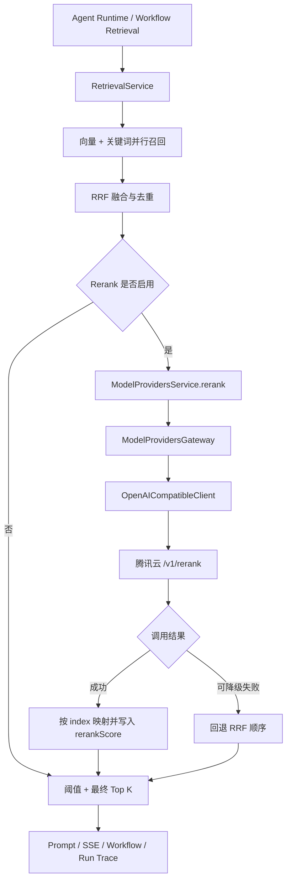

# Mia 接入腾讯云智能搜索 Rerank API 技术方案

## 1. 文档定位

本文定义 Mia 优先接入腾讯云智能搜索原子服务 OpenAI 兼容 Rerank API 的完整工程方案。

目标调用端点：

```text
POST https://bj.aisearch.tencentelasticsearch.com/v1/rerank
```

首选模型：

```text
bge-reranker-v2-m3
```

本文是 [RAG 混合双检索技术设计](./rag-hybrid-retrieval-technical-design.md) 的下一阶段方案。现有链路已经完成向量召回、关键词召回、RRF 融合与单路降级；本方案在 RRF 候选集之后增加 Cross-Encoder Rerank：

```text
向量召回 + 关键词召回
  -> RRF 融合和 Chunk 去重
  -> 腾讯云远程 Rerank
  -> Rerank 阈值过滤
  -> 最终 Top K
  -> Prompt / SSE / Workflow / Run Trace
```

文档基线日期：2026-08-25。腾讯云模型、价格、限流和服务地址属于外部配置，生产实施前需要再次核对官方控制台。

## 2. 选型结论

### 2.1 推荐方案

Mia 第一阶段直接使用腾讯云智能搜索原子服务：

```text
Provider Type: OPENAI_COMPATIBLE
Base URL: https://bj.aisearch.tencentelasticsearch.com
API Path: /v1/rerank
Auth: Authorization: Bearer sk-***
Model: bge-reranker-v2-m3
```

腾讯云官方说明该服务可以脱离 Elasticsearch 实例独立调用，接口采用 OpenAI 风格的 Bearer API Key。当前官方文档列出的 Rerank 模型包括：

- `bge-reranker-large`
- `bge-reranker-v2-m3`

官方文档：

- [OpenAI API 调用腾讯云智能搜索原子服务](https://cloud.tencent.com/document/product/845/135741)
- [知识引擎原子能力计费概述](https://cloud.tencent.com/document/product/1772/111126)

### 2.2 为什么优先选择该方案

1. Mia 已有 `OPENAI_COMPATIBLE` Provider、API Key 加密存储和统一 Gateway。
2. 接口是普通 HTTPS JSON，不需要引入腾讯云签名 SDK。
3. 不需要创建 Elasticsearch 集群。
4. 响应通过原始 `index` 映射 Chunk，适合 Mia 已有的候选数组。
5. 支持中文和多语言 RAG 场景。
6. 当前官方默认限流为 20 QPS，能够覆盖 Mia 20-50 人团队的初始规模。
7. Rerank 是无副作用、可降级的远程调用，适合放在现有 RRF 之后。

### 2.3 暂不选择的方案

| 方案                        | 暂不优先原因                                                                                                |
| --------------------------- | ----------------------------------------------------------------------------------------------------------- |
| 知识引擎 `RunRerank` 云 API | 使用 SecretId/SecretKey 和腾讯云签名协议，需要新增独立 Client；与 Mia 现有 OpenAI-compatible 网关复用度较低 |
| TI-ONE 自建 Reranker        | 需要维护模型服务、GPU、扩缩容和监控，当前团队规模投入偏高                                                   |
| 外部 Cohere/Jina Rerank     | 跨云网络和数据合规路径更复杂，腾讯云内部署时不是首选                                                        |
| LLM Post Rerank             | 成本和延迟更高，第一阶段没有必要在 Cross-Encoder 后再做一次精排                                             |

当部署环境禁止公网出口、需要严格 VPC 内网传输，或者调用量已经足以长期占用 GPU 时，再评估 TI-ONE 自建 `Qwen3-Reranker` 等模型。

## 3. 目标与非目标

### 3.1 目标

1. 为 Mia 增加正式的 `RERANK` 模型配置类型。
2. 所有 Rerank 调用统一经过 `model_providers.service -> gateway -> ProviderClient`。
3. 将现有 RRF 前 N 个候选发送到腾讯云重新排序。
4. 使用响应 `index` 安全映射回原始 Chunk。
5. Rerank 超时、限流或服务故障时自动回退到 RRF 顺序。
6. 用户取消、SSE 断开时取消腾讯云上游请求。
7. 支持 Workspace 默认模型、Agent 配置和 Workflow Retrieval 节点配置。
8. Run Trace 记录 Rerank 模型、耗时、候选数、Token 和降级状态。
9. API Key 不进入前端、业务 DTO、日志或 Trace。
10. 通过灰度开关逐 Agent 启用，关闭时保持当前行为完全不变。

### 3.2 非目标

- 不使用 Rerank 替代向量或关键词召回。
- 不把 RRF 描述为模型 Rerank。
- 不在第一阶段接入 LLM Post Rerank。
- 不把腾讯云 API 响应中的 Document 文本作为权威数据。
- 不在浏览器直接调用腾讯云。
- 不自动把全部 Agent 切换到 Rerank。
- 不改变现有知识库 Embedding 模型和向量索引。

## 4. 当前工程差距

Mia 当前已有：

- `ModelCapability` 类型包含 `rerank`。
- 模型名称能力推断可以识别包含 `rerank` 的模型名。
- Provider API Key 已加密存储。
- `OpenAICompatibleClient` 已支持 Chat 和 Embedding。
- `ModelProvidersGateway` 已负责配置加载、解密、超时和取消。
- Retrieval 已返回 `vectorScore`、`keywordScore`、`fusionScore` 和 `matchedBy`。
- Agent Runtime 和 Workflow 已记录 Retrieval diagnostics。

当前缺失：

1. Prisma `ModelConfigType` 只有 `CHAT`、`EMBEDDING`。
2. `ProviderClient` 没有 `rerank()`。
3. Gateway 和 Service 没有统一 Rerank 入口。
4. OpenAI-compatible Client 没有 `/v1/rerank` 协议实现。
5. Agent 没有 Rerank 配置。
6. Workspace 没有默认 Rerank 模型。
7. Retrieval 尚未执行远程重排。
8. 管理端当前禁用 Rerank 模型类型。
9. 缺少 Rerank 超时、限流重试、熔断和运行追踪。

## 5. 总体架构



模块依赖保持：

```text
retrieval
  -> model_providers.service
       -> model_providers.gateway
            -> ProviderClient
```

禁止：

```text
retrieval.service -> fetch 腾讯云
chat.service -> 腾讯云 SDK
workflow executor -> ProviderClient
```

## 6. 腾讯云接口契约

### 6.1 请求

```http
POST /v1/rerank
Authorization: Bearer sk-***
Content-Type: application/json
```

```json
{
  "model": "bge-reranker-v2-m3",
  "query": "ERR_DEPLOY_042 为什么发布失败",
  "documents": ["部署失败错误码 ERR_DEPLOY_042 表示制品不存在……", "灰度发布操作说明……"],
  "top_n": 5,
  "return_documents": false
}
```

字段约束：

| 字段               | Mia 行为                                          |
| ------------------ | ------------------------------------------------- |
| `model`            | 来自启用的 RERANK ModelConfig                     |
| `query`            | 使用 Retrieval 的实际查询文本                     |
| `documents`        | 使用裁剪后的候选 Chunk 文本                       |
| `top_n`            | 取 `min(finalTopK, documents.length)`             |
| `return_documents` | 固定 `false`，通过 `index` 映射，避免重复传输正文 |

### 6.2 响应

```json
{
  "object": "rerank",
  "results": [
    {
      "index": 0,
      "relevance_score": 0.9992
    },
    {
      "index": 2,
      "relevance_score": 0.939
    }
  ],
  "model": "bge-reranker-v2-m3",
  "usage": {
    "total_tokens": 218
  }
}
```

响应校验必须满足：

- `results` 是数组。
- `index` 是整数。
- `0 <= index < documents.length`。
- 同一响应不接受重复 `index`。
- `relevance_score` 是有限数字。
- 缺失或非法结果项不能覆盖其他有效候选。
- `model` 缺失时使用请求配置的模型名。
- `usage.total_tokens` 仅在合法非负整数时记录。

腾讯云返回的 `index` 是请求 `documents` 数组中的原始位置。Mia 必须通过 index 映射原始 `RetrievalSource`，不能依赖返回 Document 文本。

## 7. 数据模型设计

### 7.1 ModelConfigType

```prisma
enum ModelConfigType {
  CHAT      @map("chat")
  EMBEDDING @map("embedding")
  RERANK    @map("rerank")
}
```

PostgreSQL 迁移：

```sql
ALTER TYPE "model_config_type" ADD VALUE 'rerank';
```

### 7.2 Workspace 默认 Rerank 模型

扩展 `DefaultModelSetting`：

```prisma
model DefaultModelSetting {
  rerankModelConfigId String?      @map("rerank_model_config_id") @db.Uuid
  rerankModelConfig   ModelConfig? @relation(
    "DefaultRerankModel",
    fields: [rerankModelConfigId],
    references: [id],
    onDelete: SetNull
  )

  @@index([rerankModelConfigId], map: "idx_default_model_settings_rerank_model_config_id")
}
```

`ModelConfig` 增加反向关系：

```prisma
defaultRerankSettings DefaultModelSetting[] @relation("DefaultRerankModel")
```

Workspace 默认模型用于：

- Agent 开启 Rerank 但没有单独覆盖模型时。
- Workflow Retrieval 节点启用 Rerank 但没有指定模型时。
- 管理端快速启用和统一切换。

### 7.3 Agent Rerank 配置

建议使用明确列，不把长期运行参数塞入 `generationParams`：

```prisma
model Agent {
  rerankEnabled          Boolean      @default(false) @map("rerank_enabled")
  rerankModelConfigId    String?      @map("rerank_model_config_id") @db.Uuid
  rerankCandidateTopN    Int          @default(20) @map("rerank_candidate_top_n")
  rerankScoreThreshold   Decimal?     @map("rerank_score_threshold") @db.Decimal(6, 5)
  rerankFallbackEnabled  Boolean      @default(true) @map("rerank_fallback_enabled")
  rerankModelConfig      ModelConfig? @relation(
    "AgentRerankModel",
    fields: [rerankModelConfigId],
    references: [id],
    onDelete: SetNull
  )
}
```

`ModelConfig` 增加：

```prisma
rerankAgents Agent[] @relation("AgentRerankModel")
```

约束由 Agents Service 保证：

- `rerankCandidateTopN`：`5-50`。
- `rerankScoreThreshold`：`0-1` 或 `null`。
- `rerankModelConfigId` 必须属于同一 Workspace。
- 对应 ModelConfig 必须是 `RERANK` 且启用。
- `rerankEnabled = true` 时，Agent 覆盖或 Workspace 默认至少存在一个可用模型。

### 7.4 Workflow Retrieval 配置

Workflow 节点配置增加可选字段：

```ts
type WorkflowRetrievalConfig = {
  query: unknown;
  knowledgeBaseIds: string[];
  topK?: number;
  scoreThreshold?: number;
  rerankEnabled?: boolean;
  rerankModelConfigId?: string;
  rerankCandidateTopN?: number;
  rerankScoreThreshold?: number;
  rerankFallbackEnabled?: boolean;
};
```

发布编译时验证模型存在、类型正确、属于当前 Workspace，避免运行时才发现配置错误。

## 8. 统一 Rerank DTO

在 `model-providers/dto/llm.dto.ts` 增加：

```ts
export type RerankDocument = {
  id: string;
  text: string;
};

export type RerankRequest = {
  modelConfigId: string;
  query: string;
  documents: RerankDocument[];
  topN: number;
  timeoutSeconds?: number;
  signal?: AbortSignal;
};

export type ProviderRerankRequest = {
  query: string;
  documents: RerankDocument[];
  topN: number;
  signal: AbortSignal;
};

export type RerankResult = {
  id: string;
  index: number;
  relevanceScore: number;
};

export type RerankResponse = {
  results: RerankResult[];
  model: string;
  providerId: string;
  providerType: ModelProviderType;
  usage?: {
    totalTokens?: number;
  };
};
```

规则：

- Retrieval 传 `id`，Client 发送时只发 `text`。
- Client 使用响应 `index` 恢复 `id`。
- DTO 不包含 API Key、HTTP Header 或原始 Response。
- 对外结果不返回腾讯云内部错误对象。

## 9. Provider Client 改造

### 9.1 ProviderClient 接口

```ts
export interface ProviderClient {
  createChatCompletion(...): Promise<ChatCompletionResponse>;
  streamChatCompletion(...): AsyncIterable<ChatStreamChunk>;
  createEmbedding(...): Promise<EmbeddingResponse>;
  rerank(
    config: ProviderRuntimeConfig,
    request: ProviderRerankRequest
  ): Promise<RerankResponse>;
}
```

所有 Client 必须实现该方法：

- `OpenAICompatibleClient`：正式实现 `/v1/rerank`。
- `OllamaClient`：抛出统一的“不支持 Rerank”能力错误，除非后续有明确兼容端点。

### 9.2 OpenAICompatibleClient

新增：

```ts
async rerank(
  config: ProviderRuntimeConfig,
  request: ProviderRerankRequest
): Promise<RerankResponse> {
  const response = await fetch(this.getRerankUrl(config.baseUrl), {
    method: "POST",
    headers: this.buildHeaders(config),
    body: JSON.stringify({
      model: config.modelName,
      query: request.query,
      documents: request.documents.map((document) => document.text),
      top_n: request.topN,
      return_documents: false
    }),
    signal: request.signal
  });

  // 统一错误解析、JSON 校验和 index 映射
}
```

URL 规则：

```text
baseUrl = https://bj.aisearch.tencentelasticsearch.com
request = https://bj.aisearch.tencentelasticsearch.com/v1/rerank
```

如果管理员误填 `.../v1`，URL 归一化不得生成 `/v1/v1/rerank`。现有 Chat 和 Embedding URL 方法应一起抽取为统一的版本路径处理函数。

### 9.3 返回值安全校验

建议先解析为 `unknown`，再通过显式类型守卫读取：

```text
unknown response
  -> object 校验
  -> results array 校验
  -> 每项 index / score 校验
  -> 去除非法或重复 index
  -> 映射到 request.documents[index]
  -> 生成 Mia RerankResponse
```

如果所有结果均非法，抛出 `provider response invalid`，由 Retrieval 按配置决定是否回退 RRF。

## 10. Gateway 与 Service 改造

### 10.1 ModelProvidersService

新增公开能力：

```ts
async rerank(request: RerankRequest): Promise<RerankResponse> {
  return this.gateway.rerank(request);
}
```

新增：

```ts
async ensureEnabledRerankModelConfig(id: string): Promise<void>
```

或者复用：

```ts
ensureEnabledModelConfig(id, ModelConfigType.RERANK);
```

### 10.2 ModelProvidersGateway

Gateway 负责：

1. 查询并校验启用的 ModelConfig 和 Provider。
2. 强制 `modelType = RERANK`。
3. 解密 API Key。
4. 校验 Query、Documents 和 Top N。
5. 合并调用方 Signal 与总超时。
6. 获取全局及 Provider 并发槽位。
7. 调用 Client。
8. 执行有限重试和错误归一化。
9. 释放并发槽位、Timer 和事件监听器。

建议入口：

```ts
async rerank(request: RerankRequest): Promise<RerankResponse> {
  const prepared = await this.prepareRerankCall(request);
  return this.executeRerankWithPolicy(prepared);
}
```

### 10.3 输入限制

Gateway 最后一道限制：

```text
query: 1-1000 字符
documents: 1-50 条
document.id: 非空，且不能重复
document.text: 1-4000 字符
topN: 1-min(50, documents.length)
总字符数: 建议不超过 60,000
```

超出限制由 Retrieval 预裁剪；Gateway 仍必须防御其他调用方。

## 11. Retrieval 接入设计

### 11.1 执行位置

Rerank 放在 RRF 融合后、最终阈值和 Top K 前：

```text
双路召回
  -> RRF 候选 20-60
  -> 去重
  -> 选 Rerank Candidate Top N
  -> 腾讯云 Rerank
  -> Rerank Threshold
  -> Final Top K
```

禁止在以下位置调用：

- 向量与关键词融合之前：会增加调用次数，且失去统一候选集。
- 最终 Top K 之后：候选太少，Rerank 没有纠正排序的空间。
- Prompt 构造之后：已经无法影响 RAG 上下文。

### 11.2 Retrieval 请求扩展

```ts
export type RerankOptions = {
  enabled: boolean;
  modelConfigId?: string;
  candidateTopN?: number;
  scoreThreshold?: number;
  fallbackEnabled?: boolean;
};

export type RetrieveKnowledgeContextRequest = {
  query: string;
  knowledgeBaseIds: string[];
  topK?: number;
  scoreThreshold?: number;
  rerank?: RerankOptions;
  signal?: AbortSignal;
};
```

### 11.3 候选文本构造

不要只传裸 Chunk。建议加入有限来源信息：

```text
文档：{documentName}
片段：{chunkIndex}
内容：{content}
```

构造函数必须是纯函数：

```ts
formatRerankDocument(source: RetrievalSource): string
```

限制：

- 文档名最大 200 字符。
- Chunk 内容最大 4000 字符。
- 不传 `workspaceId`、用户 ID、API Key 等无关信息。
- 裁剪必须发生在发送腾讯云之前。

### 11.4 返回来源扩展

```ts
export type RetrievalSource = {
  // 现有字段
  score: number;
  vectorScore?: number;
  keywordScore?: number;
  fusionScore?: number;
  matchedBy?: Array<"vector" | "keyword">;

  // 新增字段
  rerankScore?: number;
  finalScore?: number;
  finalRank?: number;
};
```

语义：

- `fusionScore`：RRF 归一化结果。
- `rerankScore`：腾讯云 Cross-Encoder 相关度。
- `finalScore`：最终用于阈值和 UI 的分数。
- `score`：兼容旧调用方，Rerank 启用时等于 `finalScore`。

第一阶段建议：

```text
Rerank 成功：finalScore = clamp(rerankScore, 0, 1)
Rerank 降级：finalScore = 原 RRF 校准 score
```

不要再次把 `rerankScore` 与 `fusionScore` 加权混合，否则会削弱 Cross-Encoder 已完成的成对判断。RRF 只负责候选召回和 Rerank 前排序。

### 11.5 未返回候选处理

腾讯云 `top_n` 可能只返回部分候选。处理规则：

1. 已返回候选按 `relevance_score` 降序。
2. 应用 `rerankScoreThreshold`。
3. 未返回候选不进入最终结果。
4. 若返回合法结果为空：
   - `fallbackEnabled = true`：回退 RRF。
   - `fallbackEnabled = false`：返回空检索结果。

## 12. 配置优先级

建议固定优先级：

```text
单次 Workflow 节点配置
  -> Agent Rerank 配置
  -> Workspace 默认 Rerank 模型
  -> 未配置则关闭 Rerank
```

参数覆盖：

```text
系统安全上限
  -> ModelConfig timeout
  -> Agent 配置
  -> Workflow 节点覆盖
  -> 单次 Runtime timeout 取更小值
```

任何层级都不能突破 Gateway 的文档数、单文档长度和总字符数上限。

## 13. 超时、重试、限流与熔断

### 13.1 推荐默认值

| 参数                       |    默认值 |
| -------------------------- | --------: |
| 获取并发槽位超时           |      2 秒 |
| Rerank HTTP 总超时         |      5 秒 |
| 候选数量                   |        20 |
| 最大候选数量               |        50 |
| 单文档最大长度             | 4000 字符 |
| 总字符数上限               |     60000 |
| 全局 Rerank 并发           |         5 |
| 单 Provider 并发           |         3 |
| 可重试次数                 |         1 |
| Retry-After/Reset 最大等待 |      2 秒 |
| 连续失败熔断阈值           |      5 次 |
| 熔断冷却                   |     60 秒 |

腾讯云官方当前说明 Rerank 默认限流为 20 QPS，并提供：

```text
X-RateLimit-Limit-Requests
X-RateLimit-Remaining-Requests
X-RateLimit-Reset-Requests
```

Mia 的内部并发上限应低于外部 20 QPS，给 Embedding、人工测试和突发流量预留空间。

### 13.2 重试策略

| 错误             | 是否重试      | 行为                                  |
| ---------------- | ------------- | ------------------------------------- |
| 网络连接失败     | 是，最多 1 次 | 指数退避 + jitter                     |
| 408/429          | 是，最多 1 次 | 优先使用 Reset/Retry-After，最大 2 秒 |
| 500/502/503/504  | 是，最多 1 次 | 200-500ms jitter 后重试               |
| 400              | 否            | 配置或输入错误                        |
| 401/403          | 否            | 标记 Provider 配置异常                |
| 响应 schema 非法 | 否            | 降级并告警                            |
| 用户取消         | 否            | 立即取消整个生成链路                  |

Rerank 是只读、无副作用调用，可以安全重试一次。不要超过一次，避免尾延迟影响首 Token。

### 13.3 熔断策略

```text
closed
  -> 连续 5 次远程失败
open
  -> 冷却 60 秒
half_open
  -> 允许 1 个探测请求
  -> 成功：closed
  -> 失败：open
```

熔断范围按 Provider ID 隔离。熔断开启后，如果允许 fallback，Retrieval 直接使用 RRF，不能让全部请求继续等待同一个故障服务。

## 14. 降级策略

### 14.1 可降级错误

以下情况默认回退 RRF：

- 网络连接失败。
- Rerank 总超时。
- 腾讯云 429。
- 腾讯云 5xx。
- 响应为空或 schema 非法。
- 熔断器已打开。
- 获取并发槽位超时。

### 14.2 不应被静默掩盖的错误

以下错误仍可为本次回答回退 RRF，但必须把模型配置标记为异常并触发管理员告警：

- 401 API Key 无效。
- 403 服务未开通、账号禁用或 IP 白名单拒绝。
- 配置的模型不是 RERANK 类型。
- 模型名不受支持。
- Provider Base URL 非法。

### 14.3 禁止降级的场景

- 用户主动取消。
- SSE 客户端断开且 Chat Runtime 已决定取消上游生成。
- Workspace 权限或知识库授权失败。

取消不是服务故障，不能回退后继续生成并消耗 Token。

## 15. 错误模型

建议增加标准错误类型：

```text
rerank_invalid_request
rerank_model_not_found
rerank_provider_unauthorized
rerank_provider_forbidden
rerank_rate_limited
rerank_timeout
rerank_provider_unavailable
rerank_invalid_response
rerank_canceled
rerank_circuit_open
```

错误对象包含：

```ts
type RerankErrorMetadata = {
  providerId: string;
  modelConfigId: string;
  statusCode?: number;
  retryable: boolean;
  requestId?: string;
};
```

禁止包含：

- API Key。
- Authorization Header。
- 完整候选文档正文。
- 原始腾讯云响应中的未知敏感字段。

## 16. Run Trace 与日志

### 16.1 Retrieval diagnostics

```ts
type RetrievalDiagnostics = {
  strategy: "hybrid_rrf";
  vectorCandidateCount: number;
  keywordCandidateCount: number;
  fusedCandidateCount: number;
  degradedChannels: Array<"vector" | "keyword">;
  rerank?: {
    enabled: boolean;
    providerId?: string;
    modelConfigId?: string;
    model?: string;
    candidateCount: number;
    returnedCount: number;
    elapsedMs: number;
    usageTokens?: number;
    degraded: boolean;
    errorType?: string;
  };
};
```

### 16.2 来源 Trace

```json
{
  "chunkId": "chunk-1",
  "matchedBy": ["vector", "keyword"],
  "vectorScore": 0.81,
  "keywordScore": 1,
  "fusionScore": 0.96,
  "rerankScore": 0.992,
  "finalRank": 1
}
```

### 16.3 建议指标

```text
rerank_requests_total{provider,model,status}
rerank_latency_ms{provider,model}
rerank_candidate_count
rerank_usage_tokens_total
rerank_fallback_total{reason}
rerank_rate_limited_total
rerank_circuit_state{provider}
retrieval_rerank_empty_rate
retrieval_rank_change_rate
```

`rank_change_rate` 用于判断 Rerank 是否真正改变 RRF 排序；长期接近 0 可能意味着候选质量已足够，或模型没有产生有效区分。

## 17. 管理端设计

### 17.1 模型供应商页面

开放模型类型：

```text
Chat
Embedding
Rerank
```

腾讯云配置示例：

```text
供应商名称：腾讯云智能搜索
类型：OpenAI Compatible
Base URL：https://bj.aisearch.tencentelasticsearch.com
API Key：sk-***
模型名称：bge-reranker-v2-m3
模型类型：Rerank
超时：5 秒
```

新增测试接口：

```http
POST /api/v1/model-configs/{id}/test-rerank
```

请求：

```json
{
  "query": "Mia 如何处理部署失败",
  "documents": ["部署失败时检查构建日志和错误码。", "今天北京天气晴朗。"],
  "topN": 2
}
```

页面展示：

- 是否成功。
- 调用延迟。
- 模型名。
- 两条测试文本的排序和分数。
- 错误类型，不展示原始密钥。

### 17.2 系统默认模型

默认模型设置增加：

```text
默认 Chat 模型
默认 Embedding 模型
默认 Rerank 模型
```

### 17.3 Agent 配置

知识检索区域增加：

- 启用 Rerank。
- Rerank 模型：默认跟随 Workspace，可覆盖。
- 候选数量：默认 20。
- 最低分数：默认不设置。
- 失败回退到 RRF：默认开启。

配置提示：

```text
Rerank 会把混合检索候选文本发送到配置的远程模型服务，并增加一定响应延迟和调用费用。
```

### 17.4 Run Trace 页面

Retrieval Step 增加两个折叠区域：

1. 混合召回：向量、关键词、融合候选数。
2. Rerank：模型、耗时、Token、是否降级、排序变化。

## 18. API 设计

### 18.1 模型配置

现有 ModelConfig CRUD 复用 `modelType = RERANK`。

### 18.2 Rerank 测试

```http
POST /api/v1/model-configs/{id}/test-rerank
```

响应：

```json
{
  "model": "bge-reranker-v2-m3",
  "latencyMs": 185,
  "results": [
    {
      "index": 0,
      "relevanceScore": 0.992,
      "textPreview": "部署失败时检查构建日志……"
    }
  ],
  "usage": {
    "totalTokens": 42
  }
}
```

测试接口只允许 Workspace `OWNER` 和 `MANAGER`。

### 18.3 Agent 更新

Agent Create/Update DTO 增加：

```json
{
  "rerankEnabled": true,
  "rerankModelConfigId": null,
  "rerankCandidateTopN": 20,
  "rerankScoreThreshold": null,
  "rerankFallbackEnabled": true
}
```

`null` 模型表示跟随 Workspace 默认 Rerank 模型。

## 19. 安全与合规

### 19.1 密钥

- API Key 使用现有 `apiKeyEncrypted` 加密存储。
- 只在 Gateway 发起调用前解密。
- API 返回仅展示掩码。
- 日志统一脱敏 `Authorization`、`api_key`、`token`、`sk-*`。
- 禁止前端直接访问腾讯云。

### 19.2 数据外发

启用远程 Rerank 后，以下数据会发送到腾讯云：

- 用户检索 Query。
- RRF 候选 Chunk 的裁剪正文。
- 有限的文档名和 Chunk 序号。

不会发送：

- 用户密码。
- Mia API Key。
- Workspace 用户列表。
- Provider Secret。
- 完整知识库文档。

管理端开启前必须显示外发提示。对禁止外发的知识库，后续可以增加：

```text
knowledgeBase.allowRemoteRerank = false
```

第一阶段如果团队存在严格敏感数据，建议先以 Agent 白名单方式灰度，不要全局默认开启。

### 19.3 网络

- 只允许 HTTPS。
- Provider Base URL 禁止带用户名密码。
- 生产建议将允许主机限制为 `bj.aisearch.tencentelasticsearch.com`。
- 如果腾讯云控制台支持 IP 白名单，使用 CVM/NAT 固定出口 IP。
- DNS、连接和 TLS 错误统一归类为 Provider 网络失败。

## 20. 费用与容量估算

腾讯云官方当前公布 Rerank 基础价格为：

```text
0.0001 元 / 千 tokens
```

实际账单以腾讯云控制台为准。

估算公式：

```text
日费用 = 日 Rerank 请求数
       × 单请求平均输入 tokens
       ÷ 1000
       × 单价
```

示例：

```text
每天 10,000 次
平均每次 4,000 tokens
单价 0.0001 元/千 tokens

日费用约 = 10,000 × 4,000 / 1000 × 0.0001
          = 4 元
```

该示例只用于容量估算，不代表腾讯云账单承诺。

成本控制：

- 默认只发送 20 个候选。
- 单 Chunk 限长。
- 无候选或候选数等于 1 时跳过 Rerank。
- 相同 Query 不缓存最终 Rerank 结果，第一阶段避免权限和文档更新一致性问题。
- 记录 usage tokens 并按 Workspace 聚合。
- 设置腾讯云费用告警和后付费预算。

## 21. 测试方案

### 21.1 Client 单元测试

1. URL 正确生成 `/v1/rerank`。
2. Authorization Bearer Header 正确。
3. `return_documents` 固定为 false。
4. Documents 顺序保持不变。
5. 响应根据 index 映射原文档 ID。
6. 非法、重复、越界 index 被拒绝或过滤。
7. 空 results 返回统一错误。
8. usage token 正确归一化。
9. API Key 不进入错误信息。

### 21.2 Gateway 单元测试

1. 只允许 RERANK ModelConfig。
2. Provider 或模型禁用时拒绝调用。
3. Workspace 隔离正确。
4. 超时能够 Abort fetch。
5. 调用方取消优先于 fallback。
6. 429 按 Reset Header 最多重试一次。
7. 401/403 不重试。
8. 并发槽位始终释放。
9. 熔断状态正确流转。

### 21.3 Retrieval 单元测试

1. RRF 结果被 Rerank 重新排序。
2. 双路候选先去重再发送。
3. Candidate Top N 生效。
4. Rerank Threshold 生效。
5. 未返回候选不进入最终结果。
6. Rerank 超时回退到原 RRF 排序。
7. fallback 关闭时错误按配置处理。
8. 取消时不回退、不继续生成。
9. Rerank 关闭时输出与当前版本完全一致。
10. Trace 包含模型、耗时和排序变化。

### 21.4 前端测试

1. 能创建 Rerank ModelConfig。
2. 能执行连接测试并展示排序。
3. Agent 可启用、关闭和选择默认模型。
4. 无默认模型时给出明确校验提示。
5. Run Trace 正确展示成功和降级状态。

### 21.5 真实服务验证

准备至少四类测试：

| 类型       | Query                       | 候选预期                          |
| ---------- | --------------------------- | --------------------------------- |
| 精确错误码 | `ERR_DEPLOY_042 为什么失败` | 含完整错误码及解释的 Chunk 排第一 |
| 同义改写   | `怎样撤销刚发布的版本`      | “部署回滚流程”相关 Chunk 排前     |
| 干扰项     | `CI 构建缓存怎么清理`       | 天气、HR 制度等 Chunk 低分        |
| 中文长问题 | 多条件部署排障问题          | 包含核心处理步骤的 Chunk 优先     |

## 22. 离线评测与上线门槛

建立最小评测集：

```text
50-100 条真实 Query
每条标注 1-3 个相关 Chunk
覆盖精确词、语义改写、中文长问、无答案问题
```

对比：

```text
A: 当前 Hybrid RRF
B: Hybrid RRF + 腾讯云 Rerank
```

核心指标：

- Recall@20：验证召回候选是否包含正确答案。
- MRR@5：验证正确 Chunk 是否被提前。
- NDCG@5：验证多个相关 Chunk 的整体排序。
- 无答案误召回率。
- P50/P95 Rerank 延迟。
- Rerank 降级率。
- 平均调用 Token 和单次成本。

建议上线门槛：

```text
MRR@5 相比 RRF 提升 >= 5%
P95 Rerank 延迟 <= 1.5 秒
正常期降级率 < 1%
无答案误召回率不恶化
单次成本在预算内
```

如果 MRR 没有明显提升，不应仅因为“已经接入”就默认开启。

## 23. 发布与灰度

### 23.1 发布阶段

#### M1：模型网关

- 新增 RERANK enum 和迁移。
- 新增 Rerank DTO。
- 实现 Client、Gateway、Service。
- 增加连接测试。
- 不接入生产 Retrieval。

#### M2：Retrieval 接入

- 增加 RerankOptions。
- 完成候选裁剪、调用、映射和 fallback。
- 写入 Trace。
- 默认开关关闭。

#### M3：管理端与 Agent

- 开放 Rerank 模型配置。
- 增加 Workspace 默认模型。
- 增加 Agent 配置。
- 增加 Run Trace 展示。

#### M4：Workflow

- Retrieval 节点增加 Rerank 配置。
- Compiler 校验模型资源。
- Workflow Trace 输出 Rerank 信息。

#### M5：评测与灰度

- 建立离线评测集。
- 对一个内部 Agent 开启。
- 观察延迟、成本和降级率。
- 扩大到 10%、50%、100% Agent。

### 23.2 灰度顺序

```text
开发环境真实 API 验证
  -> 内部测试 Agent
  -> 单个低敏知识库 Agent
  -> 10% Agent
  -> 50% Agent
  -> 管理员按需全量开启
```

第一阶段不设置全局强制开启，只提供 Workspace 默认模型和 Agent 显式开关。

## 24. 回滚方案

### 24.1 应用回滚

紧急开关：

```text
MIA_RERANK_ENABLED=false
```

该开关优先级最高：

```text
全局环境变量关闭
  -> 忽略 Agent/Workflow Rerank 配置
  -> 直接使用当前 Hybrid RRF
```

### 24.2 配置回滚

- 禁用腾讯云 Rerank ModelConfig。
- 清除 Workspace 默认 Rerank 模型。
- Agent `rerankEnabled` 设置为 false。
- Workflow 发布新版本关闭 Rerank。

### 24.3 数据库回滚

新增字段保持向后兼容，可以先保留。PostgreSQL Enum 新值不建议在线删除；旧应用不会使用 `rerank` 数据即可。

回滚旧应用前必须确认：

- 旧应用查询 ModelConfig 时不会因新 enum 值失败。
- 管理端不把 RERANK 配置误当成 Chat。
- 默认设置的 Rerank 外键不影响旧字段。

## 25. 部署清单

### 25.1 腾讯云侧

- [ ] 开通智能搜索原子服务。
- [ ] 创建 API Key。
- [ ] 开通资源包或后付费。
- [ ] 设置预算和费用告警。
- [ ] 确认 CVM/NAT 可以访问服务地址。
- [ ] 配置固定出口 IP 和白名单（如启用）。
- [ ] 使用 curl 完成一次 `/v1/rerank` 验证。

### 25.2 Mia 后端

- [ ] 执行 Prisma migration。
- [ ] 创建腾讯云 OPENAI_COMPATIBLE Provider。
- [ ] 创建 `bge-reranker-v2-m3` RERANK ModelConfig。
- [ ] 执行管理端 Rerank 测试。
- [ ] 配置 Workspace 默认模型。
- [ ] 确认 Rerank 并发与超时配置。
- [ ] 确认日志不含 API Key。
- [ ] 确认全局关闭开关可用。

### 25.3 验收

- [ ] RRF 与 Rerank 排名差异可在 Trace 查看。
- [ ] 腾讯云不可用时自动回退 RRF。
- [ ] SSE 断开能够取消 Rerank 请求。
- [ ] 429 只重试一次。
- [ ] 401/403 触发管理员可见错误。
- [ ] 全量后端测试通过。
- [ ] 前端 typecheck 和 build 通过。
- [ ] 单 Agent 灰度指标达到上线门槛。

## 26. 建议代码变更清单

### 26.1 后端

```text
backend/prisma/schema.prisma
backend/prisma/migrations/*_add_rerank_model_support/migration.sql

backend/src/modules/model-providers/dto/llm.dto.ts
backend/src/modules/model-providers/dto/model-provider.dto.ts
backend/src/modules/model-providers/clients/base.client.ts
backend/src/modules/model-providers/clients/openai-compatible.client.ts
backend/src/modules/model-providers/clients/ollama.client.ts
backend/src/modules/model-providers/gateway.ts
backend/src/modules/model-providers/model-providers.service.ts
backend/src/modules/model-providers/model-configs.controller.ts

backend/src/modules/retrieval/dto/retrieval.dto.ts
backend/src/modules/retrieval/retrieval.service.ts

backend/src/modules/agents/dto/*
backend/src/modules/agents/agents.service.ts
backend/src/modules/agent_runtime/agent-runtime.service.ts
backend/src/modules/workflow_runtime/executors/retrieval.executor.ts
```

### 26.2 前端

```text
frontend/src/features/model-providers/*
frontend/src/features/agents/*
frontend/src/features/workflows/*
frontend/src/features/agent-runs/*
```

### 26.3 测试

```text
backend/src/modules/model-providers/clients/openai-compatible.client.spec.ts
backend/src/modules/model-providers/gateway.spec.ts
backend/src/modules/retrieval/retrieval.service.spec.ts
backend/src/modules/agent_runtime/agent-runtime.service.spec.ts
backend/src/modules/workflow_runtime/capability-executors.spec.ts
frontend 对应 feature 测试
```

## 27. 验收标准

方案完成必须同时满足：

1. 腾讯云真实 Rerank API 调用成功。
2. 模型配置类型正式支持 RERANK。
3. Rerank 调用只能经过 Model Providers Gateway。
4. RRF 前 20 个候选能够被远程模型重新排序。
5. `index` 映射不会错配 Chunk。
6. Rerank 失败能够回退到原 RRF 顺序。
7. 用户取消时不会回退并继续生成。
8. Run Trace 能展示 Rerank 模型、耗时、Token、分数和降级原因。
9. 管理端能创建、测试和禁用 Rerank 模型。
10. Agent 默认关闭，可独立灰度开启。
11. API Key 不出现在前端、日志和 Trace。
12. 关闭全局开关后行为与当前 Hybrid RRF 完全一致。
13. 自动化测试和真实问题集评测达到上线门槛。

## 28. 最终建议

Mia 应按以下最小可靠路径实施：

```text
腾讯云 bge-reranker-v2-m3
  + OPENAI_COMPATIBLE Provider
  + 5 秒超时
  + RRF 前 20 候选
  + 最终 Top 5
  + 失败回退 RRF
  + Provider 级并发 3
  + 连续失败 5 次熔断 60 秒
  + Agent 显式灰度开关
```

第一阶段的核心不是“发出一个 HTTP 请求”，而是建立完整的 Rerank 模型类型、Gateway 调用边界、候选裁剪、错误降级、运行追踪和灰度机制。只有这些能力同时完成，远程 Rerank 才能安全进入 Mia 的生产 RAG 链路。
